# DevTeam AI — Detailed Working Plan

| Field | Value |
|---|---|
| Document | `docs/DETAILED_WORKING_PLAN.md`. Defines **how** the roadmap is executed |
| Version | 1.0 |
| Status | **Draft, awaiting owner approval. No development has started.** |
| Date | 18 Nov 2026 |
| Authoritative scope & sequence | `docs/IMPLEMENTATION_ROADMAP.md` (v2.0). If this plan and the roadmap ever disagree, **the roadmap wins** and this plan is corrected |
| Actual history | `docs/IMPLEMENTATION_TRACKER.md` |

Identifiers used here are defined in the roadmap and are never renumbered:

- Parts **A–R**
- Milestones **M0–M5**
- Harness components **HC-01…HC-21**
- Acceptance criteria **AC-x-nn**
- Gates **G-x**
- Decisions **D-xx**
- The ten agents by their canonical names: BRD Analyst, Requirements Finalizer, Head Agent, Architecture Agent, Database Developer, Backend Developer, Frontend Developer, Testing & Validation Agent, Debugger & Code Reviewer, Documentation & Reporting Agent

---

## Table of Contents

1. [How to Use This Plan](#1-how-to-use-this-plan)
2. [Development Methodology](#2-development-methodology)
3. [Session Protocol](#3-session-protocol)
4. [Global Build Order & Technical Dependencies](#4-global-build-order--technical-dependencies)
5. [Harness Implementation Sequence](#5-harness-implementation-sequence)
6. [Agent Implementation Sequence & Standard Agent Recipe](#6-agent-implementation-sequence--standard-agent-recipe)
7. [LangGraph Workflow Development](#7-langgraph-workflow-development)
8. [LLM Gateway Development](#8-llm-gateway-development)
9. [Tool Execution & Sandbox Development](#9-tool-execution--sandbox-development)
10. [Guardrail & Approval Enforcement](#10-guardrail--approval-enforcement)
11. [Database & State Management](#11-database--state-management)
12. [Context & Memory Implementation](#12-context--memory-implementation)
13. [Testing & Evaluation](#13-testing--evaluation)
14. [Observability & Recovery](#14-observability--recovery)
15. [Security Hardening](#15-security-hardening)
16. [Repository Setup & GitHub Integration](#16-repository-setup--github-integration)
17. [Documentation & Delivery](#17-documentation--delivery)
18. [Integration & End-to-End Testing](#18-integration--end-to-end-testing)
19. [Rollback & Recovery Strategy](#19-rollback--recovery-strategy)
20. [Per-Part Execution Checklists (A–R)](#20-per-part-execution-checklists-ar)
21. [Standard Templates](#21-standard-templates)

---

## 1. How to Use This Plan

| Document | Question it answers | Who updates it | When |
|---|---|---|---|
| `IMPLEMENTATION_ROADMAP.md` | What must be built and when? | Coding agent, **only with owner approval** | When scope or sequence changes |
| `DETAILED_WORKING_PLAN.md` (this) | How is the work executed? | Coding agent, with owner approval for material changes | When execution practice changes |
| `IMPLEMENTATION_TRACKER.md` | What actually happened? | Coding agent, **in every session that changes files** | Continuously |

Every checklist item in §20 carries one of these activity labels:

| Label | Meaning | Who decides or performs |
|---|---|---|
| **[ARCH]** | Architecture decision or design confirmation | Coding agent proposes; owner confirms where a D-xx is involved |
| **[IMPL]** | Implementation activity (creating or changing files) | Coding agent |
| **[TEST]** | Writing or running automated tests | Coding agent |
| **[VAL]** | Validating acceptance criteria, reviewing evidence, regression and security checks | Coding agent; evidence shown to owner |
| **[APPR]** | User approval activity | **Owner only** |

---

## 2. Development Methodology

1. **Gated incremental delivery.** One part at a time, following the roadmap §17.1 gate procedure. Major parts never overlap.
2. **Contracts first.** Shared Pydantic contracts and harness interfaces are defined before any implementation that consumes them (Part C before every agent).
3. **Fake first, then real.** Each capability is proven with deterministic fakes before real dependencies are connected:
   - `FakeModelProvider` before Ollama;
   - stub agents before real agents;
   - stub services before real services;
   - respx-mocked GitHub before the live GitHub API.
4. **Deterministic before generative.** Anything code can decide (policy, criticality, feasibility, scheduling, status, schemas, clients, migrations) is implemented in code. LLMs fill only the gaps the specification assigns to them.
5. **Test-first for safety-critical modules.** For HC-01, HC-06, HC-13, HC-14, HC-15, HC-17, HC-21, the Completion Gate and the Requirements Policy Engine, the failing security or behaviour tests are written before the implementation.
6. **Vertical slices with demonstrable outcomes.** Each part ends with something the owner can see working (roadmap §13, "Gate demo").
7. **Evidence over claims.** Nothing is reported as passing unless it was executed in the session, with output recorded in the completion report and the tracker.
8. **Smallest safe change.** Agents and humans alike change only what the authorised scope requires. Refactoring outside scope requires owner approval.

---

## 3. Session Protocol

### 3.1 Start of every development session

1. Read `CLAUDE.md` (from Part A onward), `docs/IMPLEMENTATION_TRACKER.md` §1 *Current Status* and §11 *Next Authorised Action*.
2. Confirm that the **next authorised action** matches what is being asked. If not, stop and ask the owner.
3. Read the relevant part section of the roadmap (§13) and the part checklist in this plan (§20).
4. Check repository state: branch, clean working tree, last tag.
5. Run the fast test subset to confirm a green baseline. Record the result in the tracker.

### 3.2 During the session

- Implement only the authorised scope. If an unplanned change is needed, record it as a **deviation** in the tracker and ask the owner before proceeding if it is material.
- After every file creation, modification or deletion, add a tracker entry in the **same session**. Entries may be batched at a logical checkpoint but never deferred to a later session.
- Run tests incrementally. Record every test run (command, counts, result) in the tracker test log.

### 3.3 End of every session

1. Run the full suite relevant to the part (§13.2).
2. Update the tracker:
   - current status;
   - files changed (exact locations);
   - tests run;
   - known issues;
   - pending work;
   - next authorised action.
3. Commit work-in-progress on the part branch with a Conventional Commit message, but only once Git/GitHub use is authorised (from Part A).
4. Never mark a part complete in a session that has not run its full gate procedure.

### 3.4 Part completion (approval request)

1. Produce `docs/parts/PART-X-COMPLETION-REPORT.md` (template in §21.2).
2. Open the part PR (from Part A onward).
3. Present to the owner:
   - changed-files list;
   - test evidence;
   - acceptance-criteria table;
   - demonstration;
   - known issues.
4. **Stop and wait.** Record the owner's decision in the tracker *Approvals* table. Only after approval: merge, tag `part-x-approved`, and prepare the next part's plan.

---

## 4. Global Build Order & Technical Dependencies

```mermaid
gantt
  dateFormat X
  axisFormat %s
  title Part sequence (relative order only, not a schedule)
  section M0 Foundation
  A Foundation & benchmark        :a, 0, 1
  B Intake, IAM, audit            :b, after a, 1
  section M1 Harness & Orchestration
  C Contracts & harness core      :c, after b, 2
  D LangGraph + stubs + Head core :d, after c, 2
  E Sandbox + templates           :e, after d, 2
  F LLM Gateway + context/RAG     :f, after e, 2
  section M2 Discovery
  G Catalog + Feasibility         :g, after f, 1
  H BRD Analyst                   :h, after g, 2
  I Finalizer + approval + freeze :i, after h, 2
  section M3 Build
  J Head planner + Architect      :j, after i, 2
  K DB Dev + Backend              :k, after j, 2
  L Frontend + integration        :l, after k, 2
  section M4 Verify & Deliver
  M Tester + evidence             :m, after l, 1
  N Debugger + Completion Gate    :n, after m, 2
  O Documenter + Packager         :o, after n, 1
  P GitHub delivery               :p, after o, 1
  section M5 Evolve & Harden
  Q Change requests               :q, after p, 2
  R Hardening + acceptance        :r, after q, 2
```



Bar lengths show relative size only. No calendar dates are planned. Each part starts only after the previous gate is approved.

**Critical technical dependencies:**

| Needed by | Must exist | Why |
|---|---|---|
| Any agent code (D onward) | HC-01, HC-02 interface, HC-05, HC-06, HC-13, HC-15, HC-19, HC-20, HC-21 (C) | Agents must be unable to bypass the harness from their first line |
| Any real model call (H onward) | HC-02/03/04/16/18 implemented (F) | All model traffic goes through the gateway |
| Any generated-code execution (K onward) | HC-14 (E) | Generated code never runs on the host |
| Feasibility "supported" status (G) | Template self-test records (E) | Spec §3.4 honesty rule |
| Analyst catalog mapping (H) | Catalog enum (G) | The LLM may only map to existing keys |
| Any build-stage node (J onward) | Frozen spec + approval (I) | Spec §5.4.3 |
| Implementation agents (K, L) | Frozen contract (J) | No invented endpoints |
| Repair (N) | Real failing evidence (M) | Debugger works from actual logs |
| Docs (O) | Gate status + findings (N) | Facts first |
| Publishing (P) | Verified package (O) | Only verified artefacts are published |

---

## 5. Harness Implementation Sequence

The harness is built in this exact order. Each step lists the component(s) it covers and the part it belongs to.

| Step | Component(s) | Part | What is built | Exit test |
|---|---|---|---|---|
| HS-01 | HC-10, HC-11, HC-17 | A | `devteam_core.logging` (structlog JSON, correlation + trace IDs, redaction processor); trace-context propagation helpers | Log lines carry IDs; redaction unit tests |
| HS-02 | HC-20 | B | Upload validation models (magic bytes, size, checksum, filename) | Rejection test matrix |
| HS-03 | HC-15 | B | Human principals, roles, loopback binding, local API token, CORS middleware | Unauthenticated/cross-origin requests rejected |
| HS-04 | HC-18 | B | API token-bucket limits for upload and mutation routes | Limit exceeded → 429 |
| HS-05 | HC-21 | B | Append-only `AuditEvent` store for user actions | Audit rows for every mutation |
| HS-06 | HC-20, HC-19 | C.1 | All contracts, status enums, `RunState`, JSON Schema snapshots | Snapshot + round-trip tests |
| HS-07 | HC-15 | C.2 | Agent and service principals; permission-check API | Principal tests |
| HS-08 | HC-01 | C.2 | Policy engine (deny-by-default, role × tool × path × stage), input/output guardrail framework, `config/guardrails/*` | Policy matrix tests |
| HS-09 | HC-17 | C.2 | `SecretsManager` (keyring), secret refs, secret registry feeding redaction | Canary tests |
| HS-10 | HC-06 | C.3 | `ToolRegistry`, `ToolSpec`, Controlled File Service, knowledge-read tool interface | Path attack suite |
| HS-11 | HC-21 | C.3 | Hash chain; tool/model/file/approval/transition event types | Tamper detection |
| HS-12 | HC-19 | C.3 | Run/task state machines, repositories, attempt ledger | Illegal transitions rejected |
| HS-13 | HC-05, HC-12 | C.4 | Budget Manager, usage counters, error taxonomy, retry policy | Budget exhaustion tests |
| HS-14 | HC-13 | C.4 | Approval Service + `config/approvals.yaml` | Role/approval tests |
| HS-15 | HC-02, HC-16 | C.4 | Gateway interface + `fake` adapter; prompt registry interface | Fake gateway tests |
| HS-16 | Executor, HC-11 | C.4 | Agent SDK (`AgentSpec`, `AgentRole`, `AgentRegistry`, `AgentContext`) + Agent Executor + executor/tool spans; import-linter + banned-API rules | Dummy-agent integration test |
| HS-17 | HC-07, HC-19, HC-12, HC-13 | D | Graph, checkpointer, ledger-based idempotency, worker recovery, interrupts | Kill/restart test |
| HS-18 | HC-10, HC-11, HC-21 | D | Progress events → SSE, metrics, graph spans, trace viewer, run history | Full fake run traced |
| HS-19 | HC-14, HC-06, HC-05, HC-18 | E | Sandbox runner, recipe tools, Resource Guard, LLM/sandbox lock, image cache, Migration Runner | Isolation suite |
| HS-20 | HC-02, HC-03, HC-04 | F | Ollama adapter (localhost-only), routing, structured output, retries, fallback, OOM → WAITING | respx suite + local `llm` tests |
| HS-21 | HC-05, HC-18, HC-11 | F | Token/RAM usage, per-role rate limits, LLM/embedding caches, LLM spans | Cache/limit tests |
| HS-22 | HC-16 | F | Prompt registry over `prompts/`, hashes, active versions; CI eval-gate check | CI check fails without an eval report |
| HS-23 | HC-08 | F | Embeddings, ChromaDB per-project collections, retrieval, Context Manager, project memory API | Isolation + budget tests |
| HS-24 | HC-09 | F | Eval runner, dataset format, scorecards | Runner over fixture dataset |
| HS-25 | HC-13 | G, I, N, P, Q | Specific gates (feasibility, spec approval, test maintenance, publish, change) | Gate tests per part |
| HS-26 | HC-06 | N, P | `apply_patch` tool + diff scope checker; publish tools | Scope/publish tests |
| HS-27 | All | R | Hardening: injection corpus, fuzzing, canaries everywhere, exhaustion, recovery at every boundary | Security + acceptance suites |

---

## 6. Agent Implementation Sequence & Standard Agent Recipe

### 6.1 Sequence

| Order | Agent | Part | Increment |
|---|---|---|---|
| 0 | All ten | D | Stub implementations through the real executor + fake gateway |
| 1 | Head Agent | D | Deterministic core: validator, scheduler, dispatcher, failure router, template planner |
| 2 | BRD Analyst | H | Full |
| 3 | Requirements Finalizer | I | Full |
| 4 | Head Agent | J | LLM planner + ambiguous failure classification (+ change handler in Q) |
| 5 | Architecture Agent | J | Full |
| 6 | Database Developer | K | Full |
| 7 | Backend Developer | K | Full |
| 8 | Frontend Developer | L | Full |
| 9 | Testing & Validation Agent | M | Full |
| 10 | Debugger & Code Reviewer | N | Full |
| 11 | Documentation & Reporting Agent | O | Full |

### 6.2 Standard agent recipe (used in H, I, J, K, L, M, N, O)

Each step is one checkbox in the part checklist.

1. **[ARCH]** Confirm the agent's input/output contract from Part C. If a change is needed, bump `schema_version`, update snapshots and record the change in the tracker.
2. **[ARCH]** Confirm the `AgentSpec`: model slot, tool allowlist, write scopes, budget profile, prompt id.
3. **[IMPL]** Implement the deterministic pipeline around the model: chunking or scoping, merge, validators.
4. **[IMPL]** Write the prompt `prompts/<agent>/v1/` (system prompt, 2–3 few-shot examples, `meta.yaml`) and register it (HC-16).
5. **[IMPL]** Implement `agent.py` using only `AgentContext` (gateway + tool proxies). There must be no I/O imports; lint enforces this.
6. **[TEST]** Unit tests for deterministic logic and validators.
7. **[TEST]** Integration tests with `FakeModelProvider` fixtures: happy path, malformed output → retry, invalid output → rejection, policy violation → rejection + audit, crash → resume.
8. **[IMPL]** Build or extend the evaluation dataset under `evals/` (inputs + expected outputs).
9. **[TEST]** Run evaluations locally against real Ollama (`llm` marker) and write `docs/evals/<agent>-v1.md`.
10. **[VAL]** Compare the eval scorecard with the thresholds proposed in the part plan (D-12). Document any gap.
11. **[IMPL]** Replace the stub node in the graph with the real agent. Keep the stub available for CI fixtures.
12. **[TEST]** Graph-level integration test plus the part's E2E scenario.
13. **[VAL]** Ten-agent enforcement suite still green (L1–L4). Import-linter green.

---

## 7. LangGraph Workflow Development

| Step | Activity | Part |
|---|---|---|
| LG-01 | **[ARCH]** Freeze `RunState`, `Stage`, `NodeName`, `GateName` enums and the allowed-transition table in contracts | C |
| LG-02 | **[IMPL]** Generic `agent_node(role)` wrapper → Agent Executor; `service_node(name)` wrapper; `gate_node(name)` (side-effect-free, `interrupt()` first) | D |
| LG-03 | **[IMPL]** Discovery subgraph with fixed edges; Build subgraph with Head hub loop; Delivery subgraph; Change subgraph skeleton; parent graph | D |
| LG-04 | **[IMPL]** `build_entry_guard` (re-read Approval + SpecVersion, recompute checksum) | D (stub records), I (real records) |
| LG-05 | **[IMPL]** SqliteSaver checkpointer on `data/checkpoints.db`; thread ID = run ID; `recursion_limit` from config | D |
| LG-06 | **[IMPL]** Attempt ledger + idempotency keys; two-phase external-action helper | D |
| LG-07 | **[IMPL]** Worker: job table polling, single-run lock, heartbeat, stale-run recovery on start | D |
| LG-08 | **[IMPL]** Run control: start / pause (flag checked at node boundary) / resume / cancel / gate decision (API validates via HC-13, then `Command(resume=…)`) | D |
| LG-09 | **[IMPL]** Parallel fan-out (`Send`) only for deterministic nodes, governed by `max_parallel_deterministic` (D-27) | D |
| LG-10 | **[TEST]** Topology tests on the compiled graph: reachability, exactly 10 agent nodes, node-kind tags, transition table conformance | D |
| LG-11 | **[TEST]** Behaviour tests: interrupt/resume, kill/restart, retry limits, cancel, pause, sequential lock | D |
| LG-12 | **[IMPL]** Replace stubs with real agents/services part by part (G–Q) without changing topology unless approved | G–Q |
| LG-13 | **[IMPL]** Generate `docs/architecture/orchestration.md` diagram from the compiled graph after every topology change | D onward |

**Conventions** (written into CLAUDE.md in Part A):

- Nodes return small state updates (IDs only).
- No node holds a graph reference.
- Routing functions are pure and covered by unit tests.
- Gate nodes never write before `interrupt()`.
- Every node is wrapped by tracing and audit decorators.

---

## 8. LLM Gateway Development

| Step | Activity | Part |
|---|---|---|
| GW-01 | **[ARCH]** `ModelProvider` protocol (`generate`, `embed`, `health`, `list_models`, `unload`); `ModelRequest`/`ModelResponse` contracts | C |
| GW-02 | **[IMPL]** `LLMGateway` facade + `FakeModelProvider` (fixture-driven, deterministic); global single-call lock (process-level) | C |
| GW-03 | **[IMPL]** `OllamaProvider` with httpx; base-URL allowlist = `localhost`/`127.0.0.1`; config load fails otherwise | F |
| GW-04 | **[IMPL]** Router: role → slot → model from `config/models.yaml`; per-role overrides (D-06) | F |
| GW-05 | **[IMPL]** Structured output: JSON schema passed to Ollama `format`; Pydantic validation; bounded retry with concise validation feedback | F |
| GW-06 | **[IMPL]** Timeouts (connect/read/total); slow/OOM detection; fallback ladder; exhaustion → `WAITING_FOR_RESOURCES` + checkpoint; circuit breaker | F |
| GW-07 | **[IMPL]** Cross-process lock (file/DB lock) shared with the sandbox Resource Guard | F |
| GW-08 | **[IMPL]** Usage: token counts, duration, RAM sample; `ModelCall` record without content; LLM spans | F |
| GW-09 | **[IMPL]** Rate limits per role; LLM response cache (key = model digest + prompt hash + input hash + params; validation re-run on hit); embedding cache | F |
| GW-10 | **[IMPL]** Provider auth abstraction via HC-17 secret refs (unused by Ollama; required by any future adapter, which is disabled by policy in MVP) | F |
| GW-11 | **[IMPL]** Model unload (`keep_alive: 0`) + verification via `/api/ps` before sandbox runs | F |
| GW-12 | **[TEST]** respx-mocked suite for every path; local `llm` suite against real Ollama | F |

---

## 9. Tool Execution & Sandbox Development

| Step | Activity | Part |
|---|---|---|
| TS-01 | **[ARCH]** `ToolSpec` fields (name, version, I/O schema, allowed roles, allowed paths, timeout, side-effect class: `read`/`write`/`execute`/`external`, approval requirement, audit behaviour) | C |
| TS-02 | **[IMPL]** Controlled File Service: resolve → normalise → reject traversal, absolute, drive, UNC, symlink/junction (via `os.lstat` + reparse-point check), ADS, reserved names; enforce write allowlist; size cap; checksum; diff capture; frozen files | C |
| TS-03 | **[IMPL]** Tools: `read_project_file`, `write_project_file`, `list_project_files`, `search_project_knowledge` (interface; backed in F), `create_checkpoint` | C |
| TS-04 | **[IMPL]** Sandbox `ContainerSpec` builder (always: `network_mode=none`, `mem_limit`, `nano_cpus`, `pids_limit`, `read_only=True`, tmpfs `/tmp`, non-root `user`, single bind mount of `generated/`, no host home); wall-clock watchdog; cleanup in `finally` | E |
| TS-05 | **[IMPL]** Recipe registry: `pytest_api`, `pytest_db`, `alembic_upgrade`, `alembic_autogenerate`, `npm_build`, `tsc_check`, `vitest_run`, `ruff_check`, `bandit_scan`, `static_validation`; each with an argument schema; exposed as tools `request_build`, `request_test_run`, `request_migration_check` | E |
| TS-06 | **[IMPL]** Output capture: stdout/stderr (size-capped), exit code, JUnit XML, coverage → `runs/<run_id>/` + `TestRun` rows (runner-only write) | E, M |
| TS-07 | **[IMPL]** Resource Guard: free-RAM threshold, LLM/sandbox mutual-exclusion lock, Docker availability → Blocked | E |
| TS-08 | **[IMPL]** Offline images per template (`sandbox/images/<template>/Dockerfile`), built by a trusted script with network at build time only; dependency allowlist in `template.yaml` | E |
| TS-09 | **[IMPL]** `apply_patch` tool (unified diff) + diff scope checker (permitted files only, no `tests/` unless an approved test-maintenance task, size cap) | N |
| TS-10 | **[IMPL]** External tools `request_github_publish`, `open_pull_request` (approval-required, two-phase) | P, Q |
| TS-11 | **[TEST]** Path attack suite (hypothesis), isolation suite (`docker`), recipe validation, patch scope tests | C, E, N |

---

## 10. Guardrail & Approval Enforcement

### 10.1 Guardrail layers (HC-01)

| Layer | Checks | Where enforced | Part |
|---|---|---|---|
| Action guardrails | role × tool × path × stage; protected paths; frozen files; budgets | Policy engine (called by tool layer and executor) | C |
| Input guardrails | Size limits; type validation; untrusted-content delimiting (BRD text wrapped and labelled as data); injection-pattern flagging (a warning recorded as a Gap/audit, never executed) | Executor before model calls; extractor output | C, H |
| Output guardrails | Schema validation; provenance required; forbidden claims (an agent output asserting test results or a Verified status is rejected); secret detection; catalog-key enum | Executor after model calls | C, G |
| Stage guardrails | Build-stage tools require an approved spec version | Policy engine + build-entry guard | C, D, I |

### 10.2 Approval enforcement procedure (HC-13)

1. The UI submits a decision to `POST /api/approvals/{gate}` with the run ID and expected spec version and checksum.
2. The API resolves the principal (HC-15) and checks the role against `config/approvals.yaml`.
3. The Approval Service validates preconditions. For spec approval: no unresolved critical items, and the checksum matches the current draft.
4. It persists the `Approval` row and audit event (HC-21).
5. Only then does the API enqueue `Command(resume=approval_id)` for the worker.
6. The gate node re-reads the `Approval` by ID and verifies it matches the run and version.
7. For spec approval, `freeze_spec` writes `SpecVersion`, and `build_entry_guard` re-verifies before any build node.

### 10.3 Tests that must exist

- Unauthorised role.
- Forged resume payload (non-existent or mismatched approval ID).
- Approval with unresolved critical items.
- Stale checksum.
- Double submission of the clarification form.
- Graph reachability.
- Build-stage tool before approval.

---

## 11. Database & State Management

| Topic | Rule |
|---|---|
| Engines | `data/state.db` (domain, Alembic-managed) and `data/checkpoints.db` (LangGraph). Both SQLite with WAL, `foreign_keys=ON`, `busy_timeout` (config) |
| Ownership | `packages/state` owns models, repositories and migrations. Only repositories touch the session |
| Migrations | One Alembic revision per logical schema change; both upgrade **and** downgrade implemented; tested on a temp DB in CI; never edit an applied migration; never manual SQL |
| Backups | `scripts/backup_state.py` copies both DBs (SQLite online backup API) to `data/backups/<timestamp>/` before any migration and before each part's acceptance run |
| Large data | File contents and generated artefacts live in workspaces. SQLite stores references + checksums (Spec §12) |
| Secrets | Never in ordinary columns. Only `SecretReference` rows pointing to the keyring (HC-17) |
| Writers | API writes user-driven records; worker writes run-driven records; transactions kept short; the runner and Completion Gate are the only writers of `TestRun` results and project status |
| State machines | Run and task transitions only through `devteam_state.machines`; invalid transitions raise and are audited |
| Isolation | Every domain table carries `project_id`; repositories require it; cross-project queries are prohibited outside admin services |
| Retention | Per D-31 |

---

## 12. Context & Memory Implementation

| Memory type | Store | Lifetime | Access |
|---|---|---|---|
| Working memory | `RunState` (references) + task records | One run | Graph nodes |
| Project memory | SQLite records: requirements, decisions, approvals, artefacts, evidence | Project lifetime | Context Manager via repositories |
| Semantic memory | ChromaDB collection `project_<id>` (BRD chunks, approved spec text, approved engineering knowledge) | Project lifetime; rebuilt on manifest change | Context Manager via the retrieval tool |
| Engineering knowledge | Collection `knowledge_<version>` built from `prompts/`-adjacent coding standards and stack docs | Platform version | Read-only to all projects |

**Context Manager algorithm** (implemented in F, used from H onward):

1. Start from the task's explicit `input_artifact_refs` and `requirement_ids`. These are always included as structured records, not free text.
2. Add retrieval results (project collection first, then knowledge), filtered by `project_id` and source type.
3. Pack them in priority order within the role's token budget (config). Truncation is deterministic and recorded.
4. Wrap untrusted content in labelled delimiters (HC-01 input guardrail).
5. Record the context manifest (IDs, token counts) on the `ModelCall` record. Content is not stored.

**Rules:**

- No cross-project memory, unless the owner explicitly adds earlier documentation to a workspace (Spec §10.1).
- ChromaDB never stores project state, test results or approvals (Spec §10).

---

## 13. Testing & Evaluation

### 13.1 Test markers and locations

| Marker | Meaning | Location | CI |
|---|---|---|---|
| *(none)* | Unit | `<package>/tests/` | Yes |
| `integration` | Cross-module, temp SQLite, fake model | `tests/integration/` | Yes |
| `contract` | Schema/OpenAPI snapshots | `tests/contract/` | Yes |
| `security` | Security suite | `tests/security/` | Yes |
| `docker` | Needs Docker | `tests/integration/`, `tests/security/` | Yes (hosted runners) + local |
| `llm` | Needs local Ollama | `tests/integration/llm/` | **No** |
| `slow` | Long E2E | `tests/e2e/` | Selected |
| `acceptance` | Spec §23 scenarios | `tests/acceptance/` | No (local, R) |

### 13.2 Planned commands

These commands are planned and become valid once Part A is complete.

```text
uv sync --locked
uv run ruff check . && uv run ruff format --check .
uv run mypy packages apps agents
uv run lint-imports
uv run python scripts/check_agent_count.py
uv run pytest -m "not llm and not docker and not slow and not acceptance"   # fast suite
uv run pytest -m "docker"                                                  # sandbox suite
uv run pytest -m "llm"                                                     # local only
uv run pytest -m "security"
npm --prefix apps/web ci && npm --prefix apps/web run lint && npm --prefix apps/web run test && npm --prefix apps/web run build
gitleaks detect --no-banner
```

### 13.3 Evaluation workflow (HC-09)

1. Datasets live in `evals/datasets/` with expected outputs in `evals/expected/`, created in each agent part.
2. Run `uv run python -m devteam_harness.evaluation run --agent <name> --prompt-version vN` locally with Ollama.
3. Write the report to `evals/reports/<agent>-vN.json` + `docs/evals/<agent>-vN.md`, including the prompt hash and model digest.
4. CI check (from F): each active prompt version must have a report whose prompt hash matches. This enforces Spec §9.6 ("prompt changes must be tested against the full evaluation set").

---

## 14. Observability & Recovery

| Concern | Implementation | Part |
|---|---|---|
| Logs | structlog JSON to `data/logs/` (rotated) + console in dev; fields: `ts`, `level`, `event`, `project_id`, `run_id`, `task_id`, `trace_id`, `span_id`, `principal` | A |
| Metrics | SQLite `metrics` table: node durations, tokens, RAM samples, queue depth, sandbox durations | D, F |
| Traces | OpenTelemetry SDK with a local SQLite exporter (D-30); span hierarchy run → node → agent → model/tool | C, D, F |
| Progress | `ProgressEvent` rows → SSE `/api/runs/{id}/events` | D |
| Audit/history | Hash-chained `AuditEvent`; run history UI | B, C, D |
| Debugging | `scripts/doctor.py`; trace viewer; `--profile test` deterministic fake-model runs reproduce workflow bugs without Ollama | A, D |
| Recovery | Worker startup scan → resume stale `RUNNING` runs from the latest checkpoint; ledger prevents duplicate side effects; external actions reconcile | D |
| Resource waits | `WAITING_FOR_RESOURCES` with a reason; resume triggered by the user or when the Resource Guard reports capacity | F |

---

## 15. Security Hardening

Security work runs **throughout**, not only in Part R:

| Part | Security activities |
|---|---|
| A | Gitleaks pre-commit + CI; redaction processor; `.gitignore`/`.dockerignore` exclusions; ADRs for trust boundaries |
| B | Upload validation; loopback binding; API token; CORS; rate limits; audit of user actions; workspace isolation tests |
| C | Path attack suite; policy matrix; banned-API + import-linter rules; secret canaries; audit hash chain |
| D | Approval-bypass tests (topology + runtime); forged resume payloads |
| E | Sandbox isolation suite; no host execution path; offline images |
| F | Localhost-only provider enforcement; egress test; no content in ModelCall records; cache scoping |
| G–I | Catalog-key enum guardrail; prompt-injection delimiting; spec checksum tamper tests |
| J–L | Frozen-contract protection; generated-code secret scan; dependency allowlist |
| M–N | Results tamper protection; protected `tests/`; diff scope checker; security scanners |
| O–P | Package exclusions; publish secret-scan gate; token redaction; permission probing |
| Q | Additive-migration checker; change approval |
| R | Full hardening (roadmap §16): injection corpus, fuzzing, canaries across every sink, exhaustion, multi-project isolation, recovery at every boundary |

---

## 16. Repository Setup & GitHub Integration

### 16.1 Part A repository procedure (executed only after roadmap approval and access authorisation)

1. **[VAL]** Inspect the pre-existing workspace `.git` **read-only** (`git status`, `git log`, `git remote -v`). Report to the owner. Act per D-33.
2. **[APPR]** The owner authenticates GitHub, either with `gh auth login` in their own terminal or by setting a fine-grained token environment variable. The coding agent never asks for a token in chat.
3. **[IMPL]** Create the private repository `devteam-ai` (D-20) with `gh repo create`, then set the default branch to `main`.
4. **[IMPL]** Create the root files (roadmap §8), apply branch protection on `main` (PR required, CI status checks, no force-push), and create the `part/a-foundation` branch.
5. **[IMPL]** Move the three planning documents from the current workspace into the repository's `docs/` (as-is, recorded in the tracker).
6. **[IMPL]** Run `uv lock` to produce a fresh `uv.lock` from the actually declared dependencies, and `npm install` to produce `apps/web/package-lock.json`.
7. **[TEST]** CI runs on the PR.

### 16.2 Commit and PR conventions

| Item | Convention |
|---|---|
| Branches | `part/<letter>-<slug>`, `fix/<slug>` |
| Commits | Conventional Commits, for example `feat(harness): add controlled file service`, `test(security): add junction traversal cases`. Each commit passes the fast suite |
| PR | One per part; template = completion report summary + AC table + test evidence; requires CI green |
| Merge | Squash or merge commit (to be confirmed in Part A); only after owner approval |
| Tags | `part-<letter>-approved`; release `v1.0.0-mvp` at R |

### 16.3 Generated-application GitHub integration (Part P)

Follow roadmap §18.2. Live tests are run only with explicit owner approval at that time, against a throwaway repository.

---

## 17. Documentation & Delivery

| Artefact | Created | Updated |
|---|---|---|
| `README.md`, `CLAUDE.md`, `CHANGELOG.md` | A | Every part (CHANGELOG at approval) |
| `docs/adr/NNNN-*.md` | A | Whenever an architectural decision is made |
| `docs/architecture/*.md` | The part that introduces the subsystem | When the subsystem changes |
| `docs/parts/PART-X-PLAN.md` | Start of each part | Until plan confirmation |
| `docs/parts/PART-X-COMPLETION-REPORT.md` | End of each part | Final at the gate |
| `docs/evals/*.md` | Agent parts | On prompt/model change |
| `docs/benchmarks/*.md` | A | F, R |
| `docs/runbooks/*.md` | E onward | R (final) |
| `docs/IMPLEMENTATION_TRACKER.md` | Now | Every session with changes |
| `docs/MVP_ACCEPTANCE_REPORT.md` | R | — |

Documentation must describe the **current** state. Planned behaviour is labelled "planned".

---

## 18. Integration & End-to-End Testing

| E2E flow | First available | Model | Notes |
|---|---|---|---|
| E2E-1 Upload → extraction review | B | — | API script + manual UI |
| E2E-2 Fake full run (stubs) | D | Fake | CI (`slow`) |
| E2E-3 Template → sandbox → results | E | — | `docker` |
| E2E-4 Upload → analysis → feasibility | H | Real (local), fake (CI) | Uses eval BRDs |
| E2E-5 Intake → approval → frozen spec (both paths) | I | Real/fake | Spec scenarios #1–#8 |
| E2E-6 Frozen spec → plan → contract | J | Real/fake | #9, #10 |
| E2E-7 Contract → backend running | K | Real/fake | `docker` |
| E2E-8 Full CRUD app running | L | Real | #11, #12 |
| E2E-9 Tests + evidence | M | Real | #13 |
| E2E-10 Repair loop + gate | N | Real | #14, #15 |
| E2E-11 BRD → verified package | O | Real | #16, #17 |
| E2E-12 Publish (mock / live with approval) | P | — | #18–#20 |
| E2E-13 Change request → PR | Q | Real | #21 |
| E2E-14 Full acceptance (all 24) | R | Real | Local, checkpointed batch |

**Regression rule:** all E2E flows from previously approved parts are rerun at each gate. Fake-model variants run in CI; real-model variants run locally at milestone gates (I, L, O, P, R) and whenever a prompt or model changes.

---

## 19. Rollback & Recovery Strategy

| Scenario | Procedure |
|---|---|
| A part fails validation | Fix on the part branch → rerun the full gate. Nothing is merged. The tracker records the failure, the fix and the re-test |
| The owner rejects a part | Address the requested changes on the same branch, or abandon the branch (`git branch -D` only with owner consent). The tracker records the rejection and the outcome |
| A defect is found after a part was approved | Open `fix/<slug>` from `main`, add a regression test first, fix, run the full gate subset, and get owner approval for the fix. The tracker links the defect to its part |
| An approved part must be reverted | `git revert` of the part's merge (never a force-push to `main`); re-tag; record a deviation in the tracker |
| A schema migration goes wrong (dev) | Restore `data/backups/<timestamp>/` or run `alembic downgrade -1`; never hand-edit the DB |
| A dependency upgrade breaks things | Revert `pyproject.toml` + `uv.lock` (or `package.json` + lock) in one commit; rerun `uv sync --locked` |
| A prompt or model change degrades quality | Switch the active prompt version or model back in config (both versioned); rerun evals; record in the tracker |
| A platform run crashes | The worker resumes from the latest checkpoint; the ledger prevents duplicate side effects |
| A generated-project change goes wrong | The target workspace is a Git repo with a checkpoint/branch per change (Q); reset that workspace branch only, never the platform repo |
| A failure partway through publishing | Two-phase reconciliation (P); the package is retained; no duplicate repository |

---

## 20. Per-Part Execution Checklists (A–R)

**Format for each part:**

- **Before starting** (preconditions)
- Checklist items grouped by **[ARCH] / [IMPL] / [TEST] / [VAL] / [APPR]**
- **Demonstrate** (shown at the gate)

Acceptance-criteria IDs refer to roadmap §13.

---

### Part A: Foundation, Repository Conventions & Environment Benchmark

**Before starting:**
- [ ] Roadmap v2.0 approved.
- [ ] D-07, D-20, D-21, D-26, D-33, D-34 decided.
- [ ] Owner authorises installation of Python 3.12, Node 22, Git, Ollama and Docker, and GitHub use.

**[ARCH]**
- [ ] Write `docs/parts/PART-A-PLAN.md`: file list, package list, dependency list, benchmark candidate models. Obtain owner confirmation.
- [ ] Draft ADR-0001…0007.

**[IMPL]**
- [ ] Repository procedure §16.1, steps 1–6.
- [ ] Root files: `.python-version`, `pyproject.toml` (workspace with `packages/core`, `packages/state`, `apps/api`; agent members are added in C/D), `.gitignore`, `.gitattributes`, `.dockerignore`, `.env.example`, `.pre-commit-config.yaml`, `CHANGELOG.md`, `README.md`, `CLAUDE.md` (all conventions in roadmap §8, including the tracker rule and session protocol §3).
- [ ] `devteam_core.config` (layered, profiles) and `devteam_core.logging` (HS-01).
- [ ] `devteam_state` engine (WAL, FK, busy timeout) + Alembic baseline.
- [ ] `apps/api` app factory, `/health`, `/version`. `apps/web` shell, routing, generated client.
- [ ] Scripts: `doctor.py`, `dev.ps1`, `setup.ps1`, `benchmark_models.py`, `check_agent_count.py` (skeleton), `backup_state.py`.
- [ ] CI workflows `ci.yml`, `security.yml`.
- [ ] Install Ollama with the documented environment settings, pull the candidate models, run the benchmark (3 runs each, medians).

**[TEST]**
- [ ] Unit: config precedence/profiles, redaction, health/version, IDs.
- [ ] Integration: Alembic up/down, API boot on fresh DB, web shell render.
- [ ] Smoke: `dev.ps1`.
- [ ] CI run on the PR.

**[VAL]**
- [ ] AC-A-01…AC-A-07 table with evidence.
- [ ] `doctor.py` output captured.
- [ ] Gitleaks clean.
- [ ] Tracker fully updated.
- [ ] Completion report.

**[APPR]**
- [ ] Owner reviews the benchmark recommendation and approves the model selection (it becomes config).
- [ ] Owner approves gate **G-A**.

**Demonstrate:** clone-to-green walkthrough, CI run, doctor output, benchmark report, CLAUDE.md walkthrough.

---

### Part B: Intake, Extraction, Human IAM & Audit Foundation

**Before starting:**
- [ ] G-A approved.
- [ ] D-11, D-15, D-22, D-29, D-31 confirmed in the part plan.

**[ARCH]**
- [ ] `PART-B-PLAN.md`: data model (Project, SourceDocument, DocumentChunk, AuditEvent, Principal), chunk-ID scheme, workspace layout, upload limits.

**[IMPL]**
- [ ] Migrations for the above.
- [ ] Workspace manager.
- [ ] HS-02 upload validation.
- [ ] Extractors (PDF, DOCX, TXT/MD) + heading-aware chunker.
- [ ] HS-03 IAM middleware.
- [ ] HS-04 API rate limits.
- [ ] HS-05 audit store.
- [ ] Routers (projects, documents).
- [ ] UI: dashboard, create/upload, extraction review.
- [ ] Fixture corpus.

**[TEST]**
- [ ] Unit: extractors, chunk determinism, filename rules, rejection matrix, middleware.
- [ ] Integration: upload → workspace → DB → API; mixed good/bad files; cross-project isolation; unauthenticated rejection; audit rows.
- [ ] E2E-1.

**[VAL]**
- [ ] AC-B-01…05.
- [ ] Regression of Part A.
- [ ] Tracker + completion report.

**[APPR]** Gate **G-B**.

**Demonstrate:** sample BRD + corrupt file; reference navigation; audit rows; rejected unauthenticated call.

---

### Part C: Shared Contracts & Harness Core

**Before starting:**
- [ ] G-B approved.
- [ ] D-18, D-30, D-32 confirmed.

**[ARCH]**
- [ ] `PART-C-PLAN.md` listing every contract and its fields, derived from Spec §6 and §12. **Fields not derivable from the spec are flagged for owner review, not invented.**
- [ ] Policy file format.
- [ ] Approval types.
- [ ] Error taxonomy.

**C.1 Contracts**
- [ ] **[IMPL]** HS-06.
- [ ] **[TEST]** Round-trip + snapshots.
- [ ] **[VAL]** Checkpoint note in the tracker.

**C.2 Identity, policy, secrets**
- [ ] **[TEST first]** Policy matrix + canary tests.
- [ ] **[IMPL]** HS-07, HS-08, HS-09.
- [ ] **[VAL]** Checkpoint note.

**C.3 Tools, audit, state**
- [ ] **[TEST first]** Path attack suite (hypothesis + explicit Windows cases).
- [ ] **[IMPL]** HS-10, HS-11, HS-12.
- [ ] **[VAL]** Checkpoint note.

**C.4 Execution**
- [ ] **[IMPL]** HS-13…HS-16.
- [ ] Add all ten agent packages as workspace members containing only `AgentSpec` declarations; implementations come in D.
- [ ] Activate `check_agent_count.py`, import-linter contracts and banned-API rules.
- [ ] **[TEST]** Dummy-agent executor integration: allowed/denied calls, audit, retry, budget exhaustion.

**[VAL]**
- [ ] AC-C-01…07.
- [ ] Coverage ≥ 90% on the harness and contracts.
- [ ] Regression A–B.
- [ ] Security suite added to CI as a required check.
- [ ] Tracker + completion report.

**[APPR]** Gate **G-C**.

**Demonstrate:** live security suite; audit trail of a rejected traversal; ten-agent tests; contract snapshot.

---

### Part D: LangGraph Orchestration, Ten Stub Agents & Head Agent Deterministic Core

**Before starting:**
- [ ] G-C approved.
- [ ] D-27 confirmed.

**[ARCH]**
- [ ] `PART-D-PLAN.md`: node list with kinds, transition table, gate list, worker design, idempotency keys.

**[IMPL]**
- [ ] LG-02…LG-09.
- [ ] Stubs for all 10 agents (`stub.py`, fixture outputs via the fake gateway).
- [ ] Stub services.
- [ ] Head Agent core (validator, scheduler, dispatcher, failure router, template planner).
- [ ] Worker.
- [ ] Run control API.
- [ ] HS-17, HS-18.
- [ ] UI: build progress, gate pages, trace viewer, run history.

**[TEST]**
- [ ] LG-10, LG-11.
- [ ] Validator edge cases.
- [ ] Kill/restart recovery (spawn worker, kill process, restart, assert ledger).
- [ ] E2E-2.

**[VAL]**
- [ ] AC-D-01…06.
- [ ] Regression A–C.
- [ ] Generated graph diagram committed.
- [ ] Tracker + completion report.

**[APPR]** Gate **G-D**.

**Demonstrate:** live fake run; worker kill + recovery; rejected unapproved build; trace viewer.

---

### Part E: Isolated Execution Sandbox & Target-App Templates

**Before starting:**
- [ ] G-D approved.
- [ ] Docker installed per D-07.
- [ ] D-04, D-08, D-16, D-24 confirmed.

**[ARCH]**
- [ ] `PART-E-PLAN.md`: container limits (values), recipe list, template manifests, dependency allowlists, WSL memory cap.

**[IMPL]**
- [ ] TS-04…TS-08.
- [ ] Migration Runner.
- [ ] Integration/Build Service base.
- [ ] Both templates incl. the `req` marker plugin.
- [ ] Template self-test → `TemplateVerification` records.
- [ ] `.dockerignore` update.
- [ ] Runbook `docker-setup.md`.

**[TEST]**
- [ ] Unit: spec builder, recipes, JUnit parser.
- [ ] `docker` isolation suite: network, timeout, memory, PIDs, mount escape, cleanup, Docker-absent → Blocked, LLM/sandbox lock.
- [ ] E2E-3.

**[VAL]**
- [ ] AC-E-01…04.
- [ ] Peak memory recorded.
- [ ] Regression A–D.
- [ ] Tracker + completion report.

**[APPR]** Gate **G-E**.

**Demonstrate:** template self-tests; blocked network; timeout kill; Docker-absent → Blocked.

---

### Part F: LLM Gateway, Model Routing, Context & Memory, and RAG

**Before starting:**
- [ ] G-E approved.
- [ ] Models selected in A available locally.
- [ ] D-06, D-28 confirmed.

**[ARCH]**
- [ ] `PART-F-PLAN.md`: `models.yaml` schema, fallback ladder, timeouts, rate limits, cache policy, collection naming, context budgets per role, eval report format.

**[IMPL]**
- [ ] GW-03…GW-11.
- [ ] HS-21…HS-24.
- [ ] CI eval-gate check.
- [ ] Settings/admin UI.

**[TEST]**
- [ ] GW-12 respx suite.
- [ ] RAG ingestion/isolation/rebuild.
- [ ] Context budget.
- [ ] Cache keying/invalidation.
- [ ] Local `llm` suite.
- [ ] Scenario #22.

**[VAL]**
- [ ] AC-F-01…05.
- [ ] Egress check (no non-local endpoint configured or contacted).
- [ ] Regression A–E.
- [ ] Benchmark doc updated.
- [ ] Tracker + completion report.

**[APPR]** Gate **G-F**.

**Demonstrate:** schema-constrained call with retry; OOM fallback; project-filtered RAG query; ModelCall + trace views.

---

### Part G: Capability Catalog & Feasibility Gate

**Before starting:**
- [ ] G-F approved.
- [ ] D-01, D-02 decided.

**[ARCH]**
- [ ] `PART-G-PLAN.md`: catalog schema, entries, status rules, coverage formula, decision-gate UX.

**[IMPL]**
- [ ] Catalog files + schema + validator (reads `TemplateVerification`).
- [ ] `CatalogKey` enum.
- [ ] Feasibility engine.
- [ ] Coverage calculator.
- [ ] "SQL" rule.
- [ ] `FeasibilityItem` table.
- [ ] Report renderer.
- [ ] Feasibility UI.
- [ ] Decision gate (HS-25).

**[TEST]**
- [ ] Table-driven catalog tests.
- [ ] Power Apps / Angular / SQL Server / "SQL" / PostgreSQL / mixed fixtures.
- [ ] Demotion.
- [ ] Coverage edge cases.
- [ ] Graph integration with stub analyst.

**[VAL]**
- [ ] AC-G-01…04.
- [ ] Regression A–F.
- [ ] Tracker + completion report.

**[APPR]** Gate **G-G**.

**Demonstrate:** Power Apps flagged; demoted entry; decision recorded.

---

### Part H: BRD Analyst

**Before starting:**
- [ ] G-G approved.
- [ ] D-12 (thresholds to be proposed in plan), D-14, D-25 confirmed.

**[ARCH]**
- [ ] `PART-H-PLAN.md`: map/reduce design, ID scheme, source-validation thresholds, checklist definitions, eval dataset list (8 BRDs per Spec §9.6), proposed eval thresholds after a baseline run.

**[IMPL]**
- [ ] Standard agent recipe (§6.2) steps 3–5, 8, 11.
- [ ] DB tables for analysis records.
- [ ] `BRD_ANALYSIS.md` renderer.
- [ ] BRD Analysis UI.
- [ ] Input guardrail wiring for BRD text.

**[TEST]**
- [ ] Recipe steps 6, 7, 9, 12.
- [ ] Hallucinated-reference rejection.
- [ ] Mid-analysis crash resume.
- [ ] E2E-4.

**[VAL]**
- [ ] AC-H-01…04.
- [ ] Eval scorecard vs thresholds.
- [ ] Runtime measurements.
- [ ] Regression A–G.
- [ ] Tracker + completion report.

**[APPR]**
- [ ] Owner accepts the eval thresholds/results.
- [ ] Gate **G-H**.

**Demonstrate:** 3 contrasting BRDs; rejected citation; scorecard.

---

### Part I: Requirements Finalizer, Clarification, Approval & Spec Freeze

**Before starting:**
- [ ] G-H approved.
- [ ] D-03 confirmed.

**[ARCH]**
- [ ] `PART-I-PLAN.md`: criticality rule table (from Spec §5.4.1/§5.4.2), question model, cap/sort rules, summary template, canonical serialisation, freeze record.

**[IMPL]**
- [ ] Requirements Policy Engine.
- [ ] Question builder.
- [ ] Finalizer agent (recipe).
- [ ] Clarification form UI.
- [ ] Single-submission enforcement.
- [ ] Answer merge.
- [ ] Summary drafting.
- [ ] Approval UI with inline edit + deterministic re-check.
- [ ] Spec Freeze Service.
- [ ] `REQUIREMENTS_CONFIRMED.md`.
- [ ] Build-entry guard bound to real records.
- [ ] Cancel path.

**[TEST]**
- [ ] Unit (criticality, questions, merge, serialisation, approval logic).
- [ ] Integration: second submission, unresolved critical, tamper, build without approval.
- [ ] E2E-5 (scenarios #1–#8).

**[VAL]**
- [ ] AC-I-01…05.
- [ ] Regression A–H.
- [ ] **Milestone M2 report.**
- [ ] Tracker + completion report.

**[APPR]** Gate **G-I** (milestone gate).

**Demonstrate:** both paths; approval blocked then unblocked; tamper rejection.

---

### Part J: Head Agent Planner & Architecture Agent

**Before starting:**
- [ ] G-I approved.
- [ ] D-05 confirmed.

**[ARCH]**
- [ ] `PART-J-PLAN.md`: TaskPlan prompt design, fallback disclosure, deterministic CRUD OpenAPI baseline, `x-requirement-ids` convention, architecture validators, contract freeze record.

**[IMPL]**
- [ ] Head planner (recipe) + fallback.
- [ ] Ambiguous failure classifier.
- [ ] Progress summaries.
- [ ] Architecture Agent (recipe).
- [ ] OpenAPI baseline generator.
- [ ] Validators.
- [ ] Contract freeze + file-service frozen flag.
- [ ] Plan/architecture UI views.

**[TEST]**
- [ ] Unit validators.
- [ ] Frozen-contract write rejection.
- [ ] Invalid plan → fallback.
- [ ] E2E-6.

**[VAL]**
- [ ] AC-J-01…04.
- [ ] Eval reports.
- [ ] Regression A–I.
- [ ] Tracker + completion report.

**[APPR]** Gate **G-J**.

**Demonstrate:** DAG view + coverage; frozen contract; rejected stack drift.

---

### Part K: Database Developer & Backend Developer

**Before starting:**
- [ ] G-J approved.
- [ ] D-23 confirmed.
- [ ] D-16 flag decision.

**[ARCH]**
- [ ] `PART-K-PLAN.md`: template slots, autogenerate recipe flow, destructive-op rules, schema generation from OpenAPI, conformance diff rules, persistence heuristic.

**[IMPL]**
- [ ] Database Developer (recipe).
- [ ] Migration autogenerate + validation.
- [ ] Backend Developer (recipe).
- [ ] Schema generation.
- [ ] Contract conformance checker.
- [ ] Lint/Bandit/start/smoke recipes.
- [ ] Generated-code secret scan.

**[TEST]**
- [ ] Unit (detector, diff, heuristic, scope).
- [ ] `docker` integration (clean migration, start, CRUD persists across restart).
- [ ] E2E-7.

**[VAL]**
- [ ] AC-K-01…04.
- [ ] Eval reports.
- [ ] Regression A–J.
- [ ] Tracker + completion report.

**[APPR]** Gate **G-K**.

**Demonstrate:** running backend; empty contract diff; clean migration.

---

### Part L: Frontend Developer & Integration/Build Service

**Before starting:**
- [ ] G-K approved.
- [ ] D-09 confirmed.

**[ARCH]**
- [ ] `PART-L-PLAN.md`: client generation, page/workflow mapping, route-conformance rules, UI verification method.

**[IMPL]**
- [ ] Client generation (TS + vanilla JS).
- [ ] Frontend Developer (recipe).
- [ ] Route scanner.
- [ ] Data heuristic.
- [ ] Build/tsc/lint recipes.
- [ ] Integration/Build Service completion (compose, env, run instructions).
- [ ] UI verification per D-09.

**[TEST]**
- [ ] Unit.
- [ ] `docker` full-app integration.
- [ ] E2E-8 (scenarios #11, #12).

**[VAL]**
- [ ] AC-L-01…03.
- [ ] Regression A–K.
- [ ] **Milestone M3 report.**
- [ ] Tracker + completion report.

**[APPR]** Gate **G-L** (milestone gate).

**Demonstrate:** generated app CRUD via UI; persistence after restart.

---

### Part M: Testing & Validation Agent & Evidence Capture

**Before starting:**
- [ ] G-L approved.

**[ARCH]**
- [ ] `PART-M-PLAN.md`: marker convention, trivial-test rules, evidence model, results write protection, snapshot hash.

**[IMPL]**
- [ ] Testing & Validation Agent (recipe).
- [ ] Discovery/marker/trivial/duplicate validators.
- [ ] Runner result capture → `TestRun`/`RequirementEvidence`.
- [ ] Traceability service + UI.
- [ ] Test snapshot hash.

**[TEST]**
- [ ] Unit validators.
- [ ] Tamper rejection.
- [ ] Blocked-not-tested rule.
- [ ] E2E-9.

**[VAL]**
- [ ] AC-M-01…03.
- [ ] Regression A–L.
- [ ] Tracker + completion report.

**[APPR]** Gate **G-M**.

**Demonstrate:** traceability matrix; rejected trivial test; rejected tamper.

---

### Part N: Debugger & Code Reviewer, Repair Loop & Completion Gate

**Before starting:**
- [ ] G-M approved.
- [ ] D-10, D-17 confirmed.

**[ARCH]**
- [ ] `PART-N-PLAN.md`: repair limits, diff scope rules, test-maintenance flow, scanner set + availability disclosure, gate truth table (from Spec §18).

**[IMPL]**
- [ ] TS-09 (patch tool + scope checker).
- [ ] Debugger & Code Reviewer (recipe).
- [ ] Repair loop wiring.
- [ ] Test-maintenance gate.
- [ ] Scanners.
- [ ] Completion Gate (two-stage).
- [ ] Test/Report Centre UI.

**[TEST]**
- [ ] Scope checker.
- [ ] Gate truth table (property-based).
- [ ] Test-edit rejection.
- [ ] E2E-10 (scenarios #14, #15).

**[VAL]**
- [ ] AC-N-01…03.
- [ ] Regression A–M.
- [ ] Tracker + completion report.

**[APPR]** Gate **G-N**.

**Demonstrate:** live repair; rejected test edit; gate explanation.

---

### Part O: Documentation & Reporting Agent & Packager

**Before starting:**
- [ ] G-N approved.

**[ARCH]**
- [ ] `PART-O-PLAN.md`: fact generators per report, cross-check rules, package allow/deny lists, package verification recipe.

**[IMPL]**
- [ ] Documentation & Reporting Agent (recipe).
- [ ] Fact generators.
- [ ] Report templates.
- [ ] Cross-check + minimum-content validators.
- [ ] Packager + manifest.
- [ ] Package verification.
- [ ] Gate stage 2.
- [ ] Deliverables UI.

**[TEST]**
- [ ] Unit (generators, placeholders, cross-check, exclusions).
- [ ] Invented-endpoint rejection.
- [ ] E2E-11 (scenarios #16, #17).

**[VAL]**
- [ ] AC-O-01…03.
- [ ] Regression A–N.
- [ ] **Milestone M4 (local) report.**
- [ ] Tracker + completion report.

**[APPR]** Gate **G-O**.

**Demonstrate:** download → run from README → traceability report.

---

### Part P: GitHub Delivery for Generated Applications

**Before starting:**
- [ ] G-O approved.
- [ ] D-18, D-19 confirmed.
- [ ] Owner willing to provide a fine-grained token **via the keyring prompt in the UI**, never in chat.

**[ARCH]**
- [ ] `PART-P-PLAN.md`: permission list, scan scope, eligibility rules, report wording, two-phase steps.

**[IMPL]**
- [ ] Keyring connection.
- [ ] Permission probe.
- [ ] Secret scanner gate.
- [ ] Publish approval UI.
- [ ] Repo creation + push.
- [ ] CI + Pages workflows.
- [ ] Status polling.
- [ ] Deployment report.
- [ ] GitHub rate limiting.
- [ ] Reconciliation.

**[TEST]**
- [ ] Unit (eligibility, wording, redaction).
- [ ] respx suite (happy path, secret block, bad token, Pages ineligible, crash mid-publish).

**[VAL]**
- [ ] AC-P-01…03.
- [ ] Regression A–O.
- [ ] Tracker + completion report.

**[APPR]**
- [ ] **Separate owner approval to run the live E2E-12 against a throwaway public repo.**
- [ ] Gate **G-P**.

**Demonstrate:** blocked publish (planted fake secret); approved publish with links.

---

### Part Q: Change Requests (+ Switch-Database Extension Point)

**Before starting:**
- [ ] G-P approved.
- [ ] D-14 revisited.

**[ARCH]**
- [ ] `PART-Q-PLAN.md`: impact rules via traceability, change clarification flow, versioning, workspace branching, additive-migration rules, DB-switch extension interfaces.

**[IMPL]**
- [ ] ChangeRequest model + UI.
- [ ] Head change handler.
- [ ] Finalizer reuse for one change round.
- [ ] Spec version bump.
- [ ] Workspace branches.
- [ ] Selective dispatch.
- [ ] Additive-migration checker.
- [ ] Regression selection.
- [ ] Docs refresh.
- [ ] PR creation.
- [ ] Extension-point interfaces (no hosted DB).

**[TEST]**
- [ ] Unit (impact, additive checker).
- [ ] Integration (scoped diff, data preserved).
- [ ] E2E-13 (scenario #21, PR against the test repo with approval).

**[VAL]**
- [ ] AC-Q-01…03.
- [ ] Regression A–P.
- [ ] Tracker + completion report.

**[APPR]** Gate **G-Q**.

**Demonstrate:** change request → scoped PR with regression evidence.

---

### Part R: Hardening, Security Validation & MVP Acceptance

**Before starting:**
- [ ] G-Q approved.

**[ARCH]**
- [ ] `PART-R-PLAN.md`: hardening matrix (roadmap §16), acceptance run plan (checkpointed batch), evidence format.

**[IMPL]**
- [ ] Injection corpus.
- [ ] Fuzzers.
- [ ] Canary injection across all sinks.
- [ ] Exhaustion tests.
- [ ] Restart-at-every-boundary tests.
- [ ] UI usability fixes (within approved scope).
- [ ] Runbooks.
- [ ] Deployment & execution guide.
- [ ] Known-limitations doc.

**[TEST]**
- [ ] Full security suite.
- [ ] Failure-injection suite.
- [ ] Benchmark re-run.
- [ ] E2E-14 (all 24 scenarios).

**[VAL]**
- [ ] AC-R-01…03.
- [ ] `MVP_ACCEPTANCE_REPORT.md`.
- [ ] Full regression.
- [ ] Tracker + completion report.

**[APPR]**
- [ ] Owner accepts or waives each failed scenario explicitly.
- [ ] Gate **G-R**.
- [ ] Release tag `v1.0.0-mvp`.
- [ ] Visibility decision per D-20.

**Demonstrate:** acceptance report with evidence per scenario.

---

## 21. Standard Templates

### 21.1 `docs/parts/PART-X-PLAN.md`

```markdown
# Part X — <name> — Plan
Roadmap ref: §13 Part X · Milestone: Mn · Gate: G-X
## Scope confirmation (in / out)
## Decisions needed (D-xx) and proposed rulings
## Contracts / interfaces touched (with schema_version changes)
## Files to create / modify (paths)
## Dependencies to add (name, version constraint, reason)
## Tests to write (unit / integration / e2e / security) mapped to AC-X-nn
## Demonstration script
## Risks specific to this part
## Owner confirmation: ☐ confirmed on <date>
```

### 21.2 `docs/parts/PART-X-COMPLETION-REPORT.md`

```markdown
# Part X — <name> — Completion Report
## Summary
## Acceptance criteria
| AC | Result (Pass/Fail/Waived) | Evidence (command, file, screenshot ref) |
## Tests executed (actual)
| Suite | Command | Passed | Failed | Skipped (reason) | Date/time |
## Coverage
## Regression (previous parts)
## Security checks
## Files created / modified / deleted (see tracker CH-IDs)
## Deviations from plan
## Known issues & limitations
## Demonstration notes
## Approval requested: G-X
```

### 21.3 Approval request package

Presented to the owner at every gate:

1. Completion report link.
2. PR link (from Part A onward).
3. Changed-files list with tracker change IDs.
4. Test evidence summary (actual counts).
5. AC table.
6. Demonstration.
7. Open issues and decisions.
8. The explicit question: *"Approve gate G-X?"*
