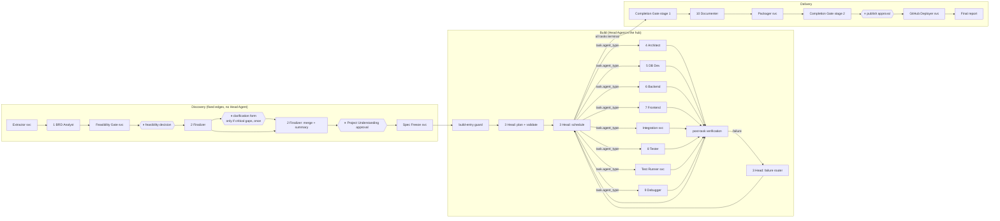
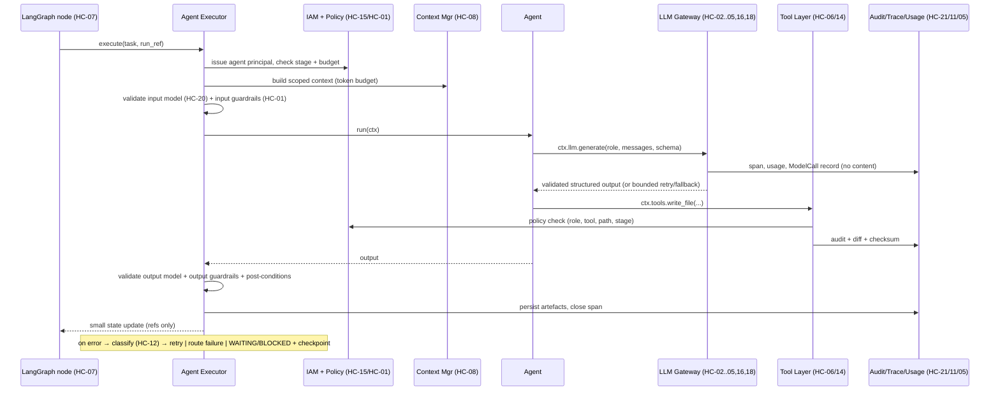
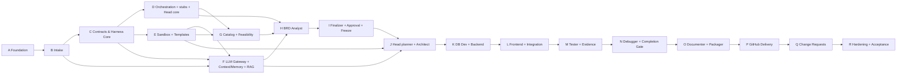
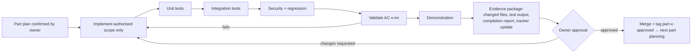

# DevTeam AI — Implementation Roadmap

| Field | Value |
|---|---|
| Document | `docs/IMPLEMENTATION_ROADMAP.md`. This is the authoritative statement of **what** must be built and **when** |
| Version | 2.0 (supersedes the 18-part draft roadmap v1.0 of 18 Nov 2026) |
| Status | **Draft, awaiting owner approval. No development has started.** |
| Date | 18 Nov 2026 |
| Source of truth | *DevTeam AI Master Business Requirements, Functional Specification & Agent Development Blueprint* v2.0 (`DevTeam_AI_Master_Development_Specification_v2.docx`, workspace root) |
| Companion documents | `docs/DETAILED_WORKING_PLAN.md` (**how**) · `docs/IMPLEMENTATION_TRACKER.md` (**what actually happened**) |
| Structure | **18 parts (A–R)** in **6 milestones (M0–M5)** · **10 agents** · **21 harness components (HC-01…HC-21)** |

Section references written "Spec §x" point to the Master Specification.

---

## Table of Contents

1. [Project Overview & Objectives](#1-project-overview--objectives)
2. [Sources, Limitations & Roadmap Review Findings](#2-sources-limitations--roadmap-review-findings)
3. [Final Architecture Overview](#3-final-architecture-overview)
4. [The Ten Agents](#4-the-ten-agents)
5. [Harness Architecture (HC-01 … HC-21)](#5-harness-architecture-hc-01--hc-21)
6. [LangGraph Orchestration Architecture](#6-langgraph-orchestration-architecture)
7. [Repository Directory Structure](#7-repository-directory-structure)
8. [Repository-Level File Conventions](#8-repository-level-file-conventions)
9. [Technology Stack & Architectural Decisions](#9-technology-stack--architectural-decisions)
10. [Dependency Map](#10-dependency-map)
11. [Milestones & Development Sequence](#11-milestones--development-sequence)
12. [Harness Component → Part Mapping](#12-harness-component--part-mapping)
13. [Detailed Part Breakdown (A–R)](#13-detailed-part-breakdown-ar)
14. [Requirements Traceability to Parts](#14-requirements-traceability-to-parts)
15. [Testing Strategy](#15-testing-strategy)
16. [Security Validation](#16-security-validation)
17. [Approval Gates](#17-approval-gates)
18. [GitHub Strategy](#18-github-strategy)
19. [Risks & Dependencies](#19-risks--dependencies)
20. [Open Decisions & Recommendations](#20-open-decisions--recommendations)
21. [Change Control for This Roadmap](#21-change-control-for-this-roadmap)

---

## 1. Project Overview & Objectives

DevTeam AI is a **local-first, BRD-driven autonomous software development platform** that runs on a single 16 GB, CPU-only Windows laptop (Spec §9.3). A user uploads a Business Requirements Document (BRD). The platform then works through these steps:

1. **Discovery (interactive, gated).**
   - Extracts the BRD with source references.
   - Builds a source-grounded requirements baseline.
   - Checks feasibility deterministically against a Capability Catalog.
   - Resolves critical gaps in **exactly one** clarification round.
   - Obtains explicit user approval of a source-tagged *Project Understanding* summary.
   - Freezes that summary as a versioned, checksummed specification.
2. **Build (autonomous, bounded).** A supervised team of agents designs, generates, assembles, tests and repairs the *target application* inside an isolated sandbox, within code-enforced budgets.
3. **Delivery (gated).**
   - A deterministic Completion Gate computes an honest status from evidence.
   - Documentation is generated from real artefacts and the project is packaged.
   - After a second explicit approval, the project is published to a **public** GitHub repository with CI, plus Pages for eligible static frontends.
   - Natural-language change requests are delivered later as pull requests.

### 1.1 Objectives of this implementation programme

| ID | Objective | Verified by |
|---|---|---|
| OBJ-1 | Deliver the MVP defined in Spec §3.2 | The 24 acceptance scenarios of Spec §23 pass (Part R) |
| OBJ-2 | Exactly ten agents, Head Agent included | Ten-agent enforcement suite (§4.4) green in every part from C onward |
| OBJ-3 | LangGraph orchestration with checkpointing, interrupts and recovery | Part D gate; re-validated in R |
| OBJ-4 | A complete harness (HC-01…HC-21) that no agent can bypass | §12 mapping complete; §16 security suite green |
| OBJ-5 | Local and free by default (no paid service or API) | Configuration audit + network-egress tests (F, R) |
| OBJ-6 | Incremental, approval-gated delivery | Each part has a recorded approval in `IMPLEMENTATION_TRACKER.md` |

### 1.2 Platform vs generated target application

These are two separate systems that must never be confused (Spec §2.1).

| | DevTeam AI **platform** | Generated **target application** |
|---|---|---|
| What | The product built by this roadmap | The application the platform produces from a user's BRD |
| Stack | React+TS+Vite, FastAPI, LangGraph, Ollama, SQLite, ChromaDB, Docker sandbox | Restricted by the Capability Catalog. MVP: React+Vite (TS) **or** plain HTML/CSS/JS + FastAPI + SQLAlchemy/Alembic + SQLite |
| Location | The `devteam-ai` repository | `workspaces/<project_id>/generated/` (never inside platform source) |

---

## 2. Sources, Limitations & Roadmap Review Findings

### 2.1 Sources analysed

| Source | Accessible? | Notes |
|---|---|---|
| Master Development Specification v2.0 (.docx) | **Yes** | Read in full (Spec §1–§27) |
| Draft 18-part roadmap v1.0 | **Yes** | Produced earlier in this planning session. Reviewed critically below |
| AI Agent Harness requirements (21 capabilities) | **Yes, as stated in the owner's instruction of 18 Nov 2026** | Any earlier harness discussion that is not in this session's context **was not accessible**. Only the 21-item list provided is used |
| Repository engineering conventions | **Partially** | The owner chose not to provide template repository files. Only the conventions described in the owner's instruction are used. Nothing is copied from other projects |

### 2.2 Critical review of the v1.0 roadmap: findings and resolutions

| ID | Finding in v1.0 | Severity | Resolution in v2.0 |
|---|---|---|---|
| RV-01 | Harness scope incomplete: no explicit IAM, rate limiting, caching, memory management, provider authentication, or execution tracing as first-class components | High | 21 harness components (HC-01…HC-21) defined in §5 and mapped to parts in §12 |
| RV-02 | Secrets management scheduled too late (Part P) even though secrets could appear earlier (logs, provider configuration) | High | Secret redaction in **A**; Secrets Manager in **C**; consumers in F and P |
| RV-03 | Stub agents in Part D called a fake model provider directly, outside a gateway | High | The **LLM Gateway interface + fake provider adapter** is established in **C**. Every model call, including stubs, goes through the gateway from day one |
| RV-04 | Part B exposed upload/project APIs before any identity or audit capability existed | Medium | Human identity, API authentication middleware and the audit store foundation move into **B** |
| RV-05 | Prompt injection through untrusted BRD content not addressed | High | Input guardrails + untrusted-content delimiting (C, H). Prompt-injection test corpus (R). Deterministic controls stay authoritative |
| RV-06 | Run lifecycle / termination statuses undefined (only task and project statuses existed) | Medium | Run status state machine defined (§6.4) |
| RV-07 | Parallel execution not addressed | Medium | Execution-concurrency policy defined (§6.6). LLM and sandbox work stay sequential per Spec §7.2 |
| RV-08 | Repository conventions (CLAUDE.md, `.python-version`, uv workspace, per-agent packages) absent | Medium | §7 and §8 define them. Created in **A** |
| RV-09 | Ten-agent limit enforced by a single test | Medium | Five-layer enforcement (§4.4) |
| RV-10 | Project deletion / data retention unspecified | Medium | Open decision D-31 |
| RV-11 | Local platform API security (CORS, local API token, request limits) unspecified | Medium | HC-15 in B, hardened in R |
| RV-12 | Spec §9.6 requires prompt changes to be re-evaluated, but v1.0 had no enforcement | Medium | CI check: each prompt version must have an eval report that references its hash (F onward) |
| RV-13 | No persistent implementation history | Medium | `docs/IMPLEMENTATION_TRACKER.md` + CLAUDE.md rule |
| RV-14 | No platform-state backup or rollback strategy | Medium | Pre-migration SQLite backup (A, D). Rollback procedures in the Working Plan |
| RV-15 | Part C overloaded | Medium | Part C keeps its single approval gate but is executed as four internal work packages C.1–C.4, each with its own tests (D-32) |
| RV-16 | Pre-existing hidden `.git` directory found in the workspace root (not created by the planner) | Medium | Open decision D-33. It is inspected, not modified, at Part A start |
| RV-17 | Observability lacked resource metrics (RAM, model load) despite the hardware constraints | Medium | HC-05 usage tracking + HC-10 metrics (D, F) |
| RV-18 | v1.0 put catalog validation in G but did not say how evidence from template self-tests is recorded | Low | Template self-test results become persisted `TemplateVerification` records (E) that the catalog validator reads (G) |
| RV-19 | Platform UI screens of Spec §20.1 not explicitly assigned | Low | Screen-to-part table (§14.3) |

**Part count after review:** the 18-part structure is **retained**. No part was merged or removed. The findings were resolved by re-assigning scope between parts and adding explicit harness work to existing parts. Splitting C into two parts (19 total) was considered and is offered as D-32. The recommendation is to keep 18 with internal work packages.

---

## 3. Final Architecture Overview

### 3.1 Runtime architecture

```mermaid
flowchart TB
  subgraph UI["Platform UI — React + TypeScript + Vite (apps/web)"]
    UIP[Projects · Upload · Extraction · Analysis · Feasibility · Clarification · Approval · Progress · Traceability · Reports · Deliverables · Change Requests · Settings]
  end
  subgraph API["Platform API — FastAPI (apps/api)"]
    MW[IAM middleware · rate limits · input validation]
    R[Routers: projects, documents, runs, approvals, clarification, reports, settings, change-requests, events SSE]
  end
  subgraph WK["Run Worker process (apps/worker) — one run at a time"]
    LG[LangGraph parent graph<br/>discovery · build · delivery · change_request subgraphs]
    subgraph H["HARNESS (packages/harness) — the only door to the outside world"]
      EX[Agent Executor + Agent SDK]
      GW[LLM Gateway<br/>routing · fallback · cache · rate limit · usage]
      TL[Controlled Tool Execution Layer]
      GR[Guardrails & Policy Engine · IAM]
      CM[Context & Memory Manager]
      SB[Sandbox Runner · Resource Guard]
      AP[Approval Service]
      OB[Audit · Tracing · Logging · Metrics]
      SM[Secrets Manager]
    end
    AG[10 agents (agents/*)]
    SV[Deterministic services (packages/services)]
  end
  DB[(SQLite state.db<br/>domain truth)]
  CK[(SQLite checkpoints.db<br/>LangGraph)]
  CH[(ChromaDB<br/>RAG only)]
  OL[Ollama — localhost only]
  DK[Docker sandbox containers<br/>network=none, limits]
  WS[[workspaces/&lt;project_id&gt;/]]
  GHB[GitHub API — only after publish approval]

  UI -- REST/SSE --> API
  API --> DB
  API -- run commands --> WK
  LG --> AG
  LG --> SV
  AG --> EX
  EX --> GW & TL & CM
  TL --> GR
  GW --> OL
  TL --> SB --> DK
  TL --> WS
  CM --> CH & DB
  LG --> CK
  SV --> TL
  TL -. publish tool, approval-gated .-> GHB
```

### 3.2 Architectural principles (each one enforced in code)

| # | Principle | Enforcement mechanism |
|---|---|---|
| P1 | No architecture or code before approval | Graph topology + build-entry guard re-validating `Approval` + spec checksum + harness pre-check on build-stage tools (§6.5) |
| P2 | No critical guessing | Requirements Policy Engine (code) classifies criticality. Unresolved critical items are excluded or block approval |
| P3 | One clarification round | DB uniqueness per spec version + API rejection + graph allows the form interrupt once |
| P4 | The LLM cannot add capabilities | Catalog keys are a closed enum validated in code |
| P5 | Agents cannot claim success | No tool exists that writes test results or project status. Only the Test Runner and the Completion Gate write them |
| P6 | Least privilege | HC-15 principals + HC-01 deny-by-default policy + HC-06 tool layer |
| P7 | Local and free | HC-02 gateway accepts only localhost providers unless an explicit per-project opt-in exists (none in MVP) |
| P8 | Sequential heavy execution | HC-05/HC-14 global locks: one model call, one sandbox run, never overlapping |
| P9 | State holds references, SQLite holds facts | `RunState` contains IDs only. Domain records live in Alembic-managed tables |
| P10 | Honest status | Completion Gate truth table + documentation cross-check validator |

---

## 4. The Ten Agents

### 4.1 Agent catalogue

Agent names below are canonical and used identically in all three documents, in code (`AgentRole` enum values in parentheses) and in package names.

| # | Agent (`AgentRole`) | Kind | Model slot | Purpose (Spec §6) | Allowed write scope | Explicitly forbidden |
|---|---|---|---|---|---|---|
| 1 | BRD Analyst (`brd_analyst`) | Specialist, Discovery | Instruct | Source-grounded requirements baseline + completeness checklist | Structured analysis records only | Shell, target code, DB mutation, GitHub |
| 2 | Requirements Finalizer (`requirements_finalizer`) | Specialist, Discovery | Instruct | One-round clarification, Project Understanding summary, approval, spec freeze | Question/answer/decision records, summary draft | Deciding criticality, a 2nd round, starting architecture, changing technology without approval |
| 3 | **Head Agent / Supervisor** (`head`) | **Supervisor**, Build + Change | Instruct (planning, ambiguous classification); **code** for everything else | Task DAG, dispatch, routing, budgets, progress, change classification | Task/plan/dispatch/status records | Writing target source, shell, tests, approvals, setting Verified |
| 4 | Architecture Agent (`architect`) | Specialist, Build | Instruct | Architecture, folder plan, OpenAPI contract (frozen), ADRs | `generated/docs/`, `generated/contracts/` | Shell, GitHub, changing the stack |
| 5 | Database Developer (`database_developer`) | Specialist, Build | Coder | SQLAlchemy models, migration inputs, DB design | `generated/database/`, backend model paths | Applying migrations itself, production DBs |
| 6 | Backend Developer (`backend_developer`) | Specialist, Build | Coder | FastAPI endpoints + business logic from the frozen contract | `generated/backend/` + shared config paths | Inventing endpoints, hardcoded secrets, fake persistence |
| 7 | Frontend Developer (`frontend_developer`) | Specialist, Build | Coder | UI + integration via the contract-generated client | `generated/frontend/` | Inventing routes, hard-coded data as persistence |
| 8 | Testing & Validation Agent (`tester`) | Specialist, Verify | Coder | Requirement-mapped tests, test plan, execution requests | `generated/tests/` | Recording results, bypassing the runner |
| 9 | Debugger & Code Reviewer (`debugger_reviewer`) | Specialist, Verify | Coder | Scoped repairs + review findings | Permitted non-test source paths (diff-scoped) | Editing tests (except an approved test-maintenance task), unrelated changes |
| 10 | Documentation & Reporting Agent (`documenter`) | Specialist, Deliver | Instruct | Factual docs and reports from real evidence | `generated/docs/`, root README of the target app | Inventing endpoints, results, files or URLs |

### 4.2 Not agents

These components **must never be registered as agents**:

- **Deterministic services:** Document Extractor, Feasibility Gate, Capability Catalog validator, Requirements Policy Engine, Integration/Build Service, Test Runner, Migration Runner, Traceability Service, Completion Gate, Packager, Secret Scanner, GitHub Deployer, Change Impact Analyser, Spec Freeze Service.
- **Harness components:** HC-01…HC-21.
- **Internal components of the Head Agent:** planner, plan validator, scheduler, dispatcher, failure router, change handler, progress summariser. These belong to Agent 3.
- **LangGraph structural nodes:** gate nodes, guard nodes, routing nodes.

### 4.3 Supervision and communication



**Communication rules:**

- Agents never call each other.
- Agents exchange data only through:
  1. typed artefacts persisted by the harness (SQLite records or checksummed workspace files);
  2. `RunState` references;
  3. Head Agent dispatch records (`input_artifact_refs`, `permitted_paths`, `done_criteria`).
- **Code** owns stage order, the next task, the agent-type → node map (closed enum), budgets, retries and stop conditions.
- **The Head Agent's LLM** proposes only the plan content (which code validates, with a deterministic fallback) and the owner of a failure when rules cannot decide.

### 4.4 Ten-agent enforcement (five layers)

| Layer | Mechanism | Introduced |
|---|---|---|
| L1 Type | `AgentRole` is a closed `StrEnum` with exactly 10 members. A unit test asserts `len(AgentRole) == 10` and the exact member set | C |
| L2 Registry | `AgentRegistry` accepts only `AgentRole` members, rejects duplicates, and refuses to start unless exactly 10 specs are registered | C (stubs), D (startup check) |
| L3 Repository | CI script asserts that `agents/` contains exactly 10 workspace member packages and that the root `pyproject.toml` lists exactly 10 agent members | A (script skeleton), C (active) |
| L4 Graph | A test on the compiled LangGraph asserts that the set of agent nodes maps one-to-one onto the 10 roles. Non-agent nodes carry a `node_kind` tag (service, gate, guard, router) | D |
| L5 Governance | CLAUDE.md forbids adding agents. Any PR touching `AgentRole`, `agents/` or the registry requires an ADR and owner approval | A |

---

## 5. Harness Architecture (HC-01 … HC-21)

The harness is the security and reliability boundary around all ten agents (Spec §11). It is **mandatory and complete**: all 21 components below are in MVP scope.

### 5.1 Component definitions

| ID | Component | Responsibility | Key mechanisms | Package path (`packages/harness/src/devteam_harness/…`) |
|---|---|---|---|---|
| HC-01 | Guardrails & Deterministic Policy Enforcement | Allow or deny every action. Input/output guardrails | Deny-by-default policy (role × tool × path × stage); input guardrails (size, type, untrusted-content delimiting, injection-pattern flagging); output guardrails (schema, provenance, secret detection, forbidden claims such as "tests passed") | `guardrails/` + `config/guardrails/` |
| HC-02 | Centralized LLM Gateway | The **only** path to any model | `LLMGateway.generate()` / `.embed()`; global single-call lock; request normalisation; structured output; usage hooks; audit hooks | `llm_gateway/gateway.py` |
| HC-03 | Model Abstraction & Routing | Provider-agnostic adapters; role → slot → model | `ModelProvider` protocol; adapters `ollama`, `fake` (tests); future adapters behind an opt-in policy; routing table in `config/models.yaml` | `llm_gateway/router.py`, `llm_gateway/providers/` |
| HC-04 | Provider Authentication, Timeouts & Model Fallback | Credentials for providers that need them (none for local Ollama); per-call timeouts; fallback ladder | Provider auth via HC-17 secret refs; connect/read timeouts; fallback to a smaller local model; OOM/slow detection; exhaustion → checkpoint + `WAITING_FOR_RESOURCES` | `llm_gateway/providers/`, `llm_gateway/fallback.py` |
| HC-05 | Token, Resource & Usage Tracking | Measure and enforce consumption | Per-call token counts, durations; per-task/per-run budgets (time, tokens, calls, retries, context); RAM sampling (psutil); persisted counters | `budgets/`, `usage/` |
| HC-06 | Controlled Tool Execution Layer | Typed, audited tools; no generic shell | `ToolRegistry` + `ToolSpec` (name, version, I/O schema, allowed roles, paths, timeout, side-effect class, approval requirement, audit behaviour); Controlled File Service (Windows-aware path safety); recipe-based command tools | `tools/` |
| HC-07 | LangGraph Orchestration Runtime | Graph construction, node wrappers, routing, interrupts | Parent graph + 4 subgraphs; node wrapper calling the executor; closed `NodeName` enum + allowed-transition table | `packages/orchestration` (uses harness) |
| HC-08 | Context & Memory Management | Minimal per-task context; project memory | Context Manager (token-budgeted assembly from SQLite + RAG); **working memory** = RunState refs; **project memory** = SQLite records/decisions; **semantic memory** = ChromaDB per-project collections; no cross-project memory | `context/`, `memory/`, `rag/` |
| HC-09 | Evaluation & Output Validation | Quality evidence for agent outputs | Deterministic semantic validators (source grounding, coverage, contract conformance); eval datasets + runner + scorecards; eval-gated prompt changes | `evaluation/` + root `evals/` |
| HC-10 | Observability & Structured Logging | Logs + metrics + progress | structlog JSON with correlation IDs and redaction; metrics (durations, tokens, RAM, queue depth) in SQLite; progress events → SSE | `observability/` (logging setup in `devteam_core`) |
| HC-11 | Execution Tracing | End-to-end trace of every run | Trace/span IDs for run → node → agent → model call / tool call; OpenTelemetry API with a **local** exporter to SQLite (D-30); trace viewer in the UI | `observability/tracing.py` |
| HC-12 | Retry, Recovery & Fault Tolerance | Bounded retries and safe resume | Error taxonomy (retryable / fatal / budget / policy); retry policy with backoff; idempotency ledger; checkpoint resume; worker crash recovery; circuit breaker on the gateway | `resilience/` |
| HC-13 | Human-in-the-Loop Approvals | Approval gates enforced in code | `ApprovalService` (types: feasibility_decision, spec_approval, substitution, test_maintenance, publish_github, destructive_db, db_switch); role checks; graph `interrupt()` + validated `Command(resume=…)` | `approvals/` |
| HC-14 | Isolated Sandbox & Execution Controls | Run generated code safely | Docker runner: `network=none`, memory/CPU/PIDs/wall-clock limits, non-root, read-only rootfs + tmpfs, single workspace mount, destroy after run; Resource Guard (no overlap with model calls); Migration Runner | `sandbox/` |
| HC-15 | Identity & Access Management | Who (human, agent, service) may do what | Human principals: single local user holding roles project_user / administrator / reviewer (Spec §4); local API token + CORS + loopback binding; agent principals `agent:<role>:<task_id>`; service principals; permission checks used by HC-01 and HC-13 | `iam/` (+ API middleware) |
| HC-16 | Prompt Management & Versioning | Versioned, hashed, eval-gated prompts | Prompt registry over `prompts/<agent>/vN/` (system prompt, few-shots, metadata); content hash recorded per model call; active-version config; eval report required per version | `prompts/` |
| HC-17 | Secrets Management | Store and use secrets without exposure | `SecretsManager` backed by the OS keyring (Windows Credential Manager) (D-18); secret references, never values, in DB/config; registry of known secret values for redaction; secrets never sent to models | `secrets/` |
| HC-18 | Rate Limiting & Caching | Protect resources; avoid recomputation | Token-bucket limits: API endpoints (B), gateway calls per role (F), GitHub API (P). Caches: LLM response cache keyed by (model digest, prompt hash, input hash, params) (D-28); embedding cache; sandbox image/dependency cache | `ratelimit/`, `llm_gateway/cache.py` |
| HC-19 | Workflow State Management | Durable run/task state | `RunState` contract; run and task status state machines (§6.4); SQLite repositories; SqliteSaver checkpointer; attempt ledger | `packages/state` + `packages/orchestration/state.py` |
| HC-20 | Input & Output Validation | Structural validation at every boundary | Pydantic v2 models for API requests, uploads (magic bytes, size, checksum), agent I/O, tool I/O and config files; JSON Schema snapshots | `devteam_core.contracts` + validation hooks in executor and tools |
| HC-21 | Security Auditing & Execution History | Tamper-evident record of everything | Append-only, hash-chained `AuditEvent` table; tool-call, model-call, file-change (diff + checksum), approval, status-transition records; run history views; redaction | `audit/` |

### 5.2 Agent execution lifecycle (every agent, every invocation)



### 5.3 Non-bypass guarantees

| Bypass vector | Prevention | Verification |
|---|---|---|
| Agent imports `httpx`/`requests`/`ollama` directly | Ruff `flake8-tidy-imports` banned-API rules for `agents/**`; import-linter contracts | CI lint + import-linter (C onward) |
| Agent uses `open`, `os`, `pathlib` writes, `subprocess`, `shutil`, `docker` | Banned-API rules for `agents/**`; the `AgentContext` exposes only tool proxies | CI lint + security tests |
| Agent imports another agent | Import-linter "independence" contract across the 10 agent packages | CI |
| Agent calls an unregistered tool | `ToolRegistry` raises; audited | Security tests (C) |
| Model call outside the gateway | Only `llm_gateway.providers` may import HTTP clients | Import-linter (C) |
| Build node reached without approval | Topology + guard node + harness stage check | Reachability test + runtime test (D, I) |
| Generated code reaches the network | Sandbox `network=none` | Sandbox security tests (E, R) |
| Secrets in prompts/logs/repo | Redaction processor, secret registry, Gitleaks gates | Canary-secret tests (C, R) |

---

## 6. LangGraph Orchestration Architecture

### 6.1 Graph topology

- **Parent graph** `project_run` with four compiled subgraphs: `discovery`, `build`, `delivery` and `change_request`. Parent edges allow only Discovery → Build → Delivery. `change_request` is a separate entry point for an existing project with a frozen spec.
- **Thread ID = `run_id`.** A project has one initial run and one run per change request.
- **Checkpointer:** `SqliteSaver` on `data/checkpoints.db`, separate from `data/state.db`.
- **Node kinds** (tagged in metadata): `agent` (10 roles), `service`, `gate` (interrupt), `guard`, `router`.
- **Routing:** pure functions in `routing.py` that return members of a closed `NodeName` enum. Every transition is checked against a static allowed-transition table. Violations raise `IllegalTransition` and are audited.

### 6.2 Agent registration and execution

- Each agent package exposes one `AgentSpec`: role, model slot, prompt id + version, input/output models, tool allowlist, write paths and budget profile.
- The orchestration layer builds one node per `AgentRole` through a generic `agent_node(role)` wrapper that calls the Agent Executor. Agents never receive the graph object.

### 6.3 Handoffs

| Handoff | Mechanism |
|---|---|
| Discovery stages | Fixed edges (no LLM routing) |
| Build tasks | Head scheduler selects the next ready task. The router maps `task.agent_type` → node |
| Failure → owner | Head failure router: rules table (path prefix, failing test marker, error class), then an LLM classification only if ambiguous (validated against the enum) |
| Repair loop | Runner → Debugger → Runner, bounded by HC-05 counters + `recursion_limit` backstop |

### 6.4 Status models

| Model | States | Owner |
|---|---|---|
| **Run status** (new) | `CREATED → RUNNING ⇄ PAUSED`; `RUNNING → WAITING_FOR_HUMAN → RUNNING`; `RUNNING → WAITING_FOR_RESOURCES → RUNNING`; terminal: `COMPLETED`, `CANCELLED`, `FAILED`, `BLOCKED` | HC-19 state machine. Transitions are validated and audited |
| **Task status** (Spec §20.2) | Pending, Ready, Running, Completed, Partially Completed, Blocked, Failed, Skipped, Cancelled | Head scheduler + executor |
| **Project verification status** (Spec §18.1) | Generated, Build Passed, Tests Passed, Requirements Verified, Partially Verified, Blocked, Failed, Verified | **Completion Gate only** |

**Termination rules:**

- **Cancel** is cooperative and takes effect at the next node boundary, leaving a final checkpoint.
- **FAILED** means a non-recoverable error or the repair limit was reached.
- **BLOCKED** means a missing capability, credential or resource with no fallback.
- **COMPLETED** means the delivery subgraph finished. COMPLETED does **not** imply Verified.

### 6.5 Human approval checkpoints (defence in depth)

| Gate node | Approval type (HC-13) | Required role | Part |
|---|---|---|---|
| `feasibility_decision` | feasibility_decision | project_user | G (per D-01) |
| `clarification_form` | (form submission, once) | project_user | I |
| `project_approval` | spec_approval | project_user | I |
| `test_maintenance_approval` | test_maintenance | reviewer | N |
| `publish_approval` | publish_github | project_user + reviewer | P |
| `change_approval` | spec_approval (new version) | project_user | Q |
| `db_switch_approval` | db_switch / destructive_db | reviewer | extension point only (Q) |

Approval enforcement has three layers:

1. No edge reaches Build except through `freeze_spec`.
2. The `build_entry_guard` node re-reads `Approval` + `SpecVersion` from SQLite and recomputes the checksum.
3. Every build-stage tool call checks that the run's spec version is approved.

### 6.6 Sequential and parallel execution policy

| Work type | Concurrency in MVP | Basis |
|---|---|---|
| LLM calls (any agent) | **1**, globally locked | Spec §7.2 |
| DB / Backend / Frontend agents | **Sequential** | Spec §7.2 |
| Sandbox runs | **1**, never overlapping an LLM call | Spec §7.2, §9.3 |
| Deterministic low-memory nodes (multi-file extraction, static validators) | Configurable LangGraph fan-out (`Send`). **Default 1 on the `low_memory` profile** | D-27 |

### 6.7 Checkpointing, pause/resume and recovery

- Checkpoints are written after every node (LangGraph default). Meaningful-stage checkpoints are also labelled for the UI.
- **Idempotency:** LangGraph re-executes an interrupted node from its start. Therefore:
  - gate nodes perform no side effects before `interrupt()`;
  - side-effecting nodes consult the attempt ledger (`run_id:node:task_id:attempt`);
  - external actions are two-phase (intent → perform → confirm) with reconciliation on resume.
- **Worker crash:** on restart, the worker finds runs in `RUNNING` with a stale heartbeat and resumes them from the latest checkpoint.

### 6.8 RunState (illustrative; final contract in Part C)

```python
class RunState(TypedDict):
    project_id: str
    run_id: str
    run_kind: Literal["initial", "change_request"]
    stage: Stage  # closed enum
    spec_version_id: str | None  # set only by freeze_spec
    spec_checksum: str | None
    contract_version_id: str | None
    plan_id: str | None
    current_task_id: str | None
    pending_gate: GateName | None
    blocker_ids: list[str]
    last_error: ErrorRef | None
    trace_id: str
```

---

## 7. Repository Directory Structure

Recommended layout: a **uv workspace monorepo** with one isolated package per agent (D-26, superseding D-13). Directories marked *(gitignored)* exist only locally.

```text
devteam-ai/
├── .github/
│   └── workflows/
│       ├── ci.yml                    # lint, type, unit, integration, security, docker-marked tests
│       └── security.yml              # gitleaks, pip-audit, npm audit (PR + weekly)
├── apps/
│   ├── api/                          # FastAPI platform API (package: devteam_api)
│   │   ├── pyproject.toml
│   │   └── src/devteam_api/{main.py, routers/, middleware/, deps.py, sse.py}
│   ├── worker/                       # LangGraph run worker process (package: devteam_worker)
│   │   ├── pyproject.toml
│   │   └── src/devteam_worker/{main.py, queue.py, heartbeat.py, recovery.py}
│   └── web/                          # React + TypeScript + Vite platform UI
│       ├── package.json  package-lock.json  vite.config.ts  tsconfig.json
│       └── src/{pages/, features/, components/, api/, hooks/, types/}
├── packages/
│   ├── core/                         # devteam_core — shared foundation, no internal deps
│   │   └── src/devteam_core/{config/, logging/, ids.py, errors.py, paths.py, clock.py,
│   │                         contracts/{records, agents, tasks, events, tools, statuses, state}}
│   ├── state/                        # devteam_state — SQLAlchemy models, repositories, Alembic
│   │   ├── alembic.ini
│   │   └── src/devteam_state/{models/, repositories/, migrations/, checkpointer.py, machines.py}
│   ├── harness/                      # devteam_harness — HC-01…HC-21 (except HC-07 graph defs)
│   │   └── src/devteam_harness/{agent_sdk/, executor/, guardrails/, iam/, llm_gateway/{providers/},
│   │                            prompts/, context/, memory/, rag/, tools/, sandbox/, approvals/,
│   │                            secrets/, budgets/, usage/, ratelimit/, resilience/,
│   │                            observability/, audit/, evaluation/}
│   ├── orchestration/                # devteam_orchestration — LangGraph (HC-07)
│   │   └── src/devteam_orchestration/{graph.py, state.py, routing.py, guards.py,
│   │                                  nodes/, subgraphs/{discovery, build, delivery, change_request}.py}
│   └── services/                     # devteam_services — deterministic services (NOT agents)
│       └── src/devteam_services/{extractor/, catalog/, feasibility/, requirements_policy/,
│                                 spec_freeze/, integration_builder/, test_runner/, traceability/,
│                                 completion_gate/, packager/, secret_scanner/, github_deployer/,
│                                 change_impact/}
├── agents/                           # EXACTLY 10 packages; namespace package devteam_agents.*
│   ├── brd_analyst/                  # each: pyproject.toml, src/devteam_agents/<name>/{agent.py,
│   ├── requirements_finalizer/       #        pipeline.py, stub.py}, tests/
│   ├── head/
│   ├── architect/
│   ├── database_developer/
│   ├── backend_developer/
│   ├── frontend_developer/
│   ├── tester/
│   ├── debugger_reviewer/
│   └── documenter/
├── config/                           # centralized configuration (validated at startup)
│   ├── defaults.yaml
│   ├── profiles/{low_memory.yaml, standard.yaml, test.yaml}
│   ├── guardrails/{policies.yaml, input_guardrails.yaml, output_guardrails.yaml, protected_paths.yaml}
│   ├── models.yaml                   # slots, routing, fallback ladder, timeouts
│   ├── budgets.yaml
│   ├── rate_limits.yaml
│   └── approvals.yaml                # approval type → required roles
├── capability_catalog/{capabilities.yaml, schema/capabilities.schema.json}
├── prompts/<agent>/v<N>/{system.md, examples/, meta.yaml}   # HC-16
├── templates/target_apps/{react_fastapi_sqlite/, html_fastapi_sqlite/}   # each with template.yaml
├── sandbox/images/<template>/Dockerfile   # pinned offline test images
├── evals/{datasets/brds/, expected/, reports/}               # HC-09 data (runner lives in harness)
├── tests/                            # cross-package suites (unit tests live inside each package)
│   ├── integration/  e2e/  security/  contract/  acceptance/  fixtures/
├── scripts/{setup.ps1, doctor.py, dev.ps1, benchmark_models.py, check_agent_count.py,
│            backup_state.py}
├── docs/
│   ├── IMPLEMENTATION_ROADMAP.md  DETAILED_WORKING_PLAN.md  IMPLEMENTATION_TRACKER.md
│   ├── architecture/  adr/  benchmarks/  runbooks/  parts/  evals/
├── data/          (gitignored)       # state.db, checkpoints.db, chroma/, traces
├── workspaces/    (gitignored)       # per-project isolated workspaces
├── .dockerignore  .gitattributes  .gitignore  .python-version  .env.example
├── .pre-commit-config.yaml  CHANGELOG.md  CLAUDE.md  README.md  pyproject.toml  uv.lock
└── LICENSE        (pending D-21)
```

### 7.1 Directory responsibilities and dependency rules

| Directory | Responsibility | May depend on | Must not depend on |
|---|---|---|---|
| `packages/core` | Contracts, config, logging, IDs, errors, paths | stdlib, pydantic, structlog | Any internal package |
| `packages/state` | Persistence, migrations, state machines, checkpointer | core | harness, agents, services |
| `packages/harness` | HC-01…HC-21 implementations and Agent SDK | core, state | agents, orchestration, apps |
| `packages/services` | Deterministic services | core, state, harness (tools/sandbox/gateway interfaces) | agents |
| `agents/*` | One agent each | core, `devteam_harness.agent_sdk` **only** | Other agents, services, state, any I/O library |
| `packages/orchestration` | Graph wiring | core, state, harness, services, agents | apps |
| `apps/api` | HTTP surface | core, state, harness (IAM, approvals), orchestration (run commands only) | agents directly |
| `apps/worker` | Executes runs | orchestration, harness, state | — |
| `apps/web` | UI | API over HTTP only | — |
| `config/`, `capability_catalog/`, `prompts/` | Versioned configuration, validated at startup | — | — |
| `templates/`, `sandbox/images/` | Target-app starters and test images | — | Platform source |
| `evals/` | Evaluation data and reports | — | — |

These rules are enforced by declared workspace dependencies plus **import-linter** contracts in CI.

---

## 8. Repository-Level File Conventions

| File | Purpose | Key content | Created | Updated |
|---|---|---|---|---|
| `.python-version` | Pins the interpreter for uv and tooling | `3.12` | A | On approved Python upgrades only |
| `pyproject.toml` (root) | uv **workspace root** + shared tool config | `[tool.uv.workspace] members = [...]` (apps, packages, exactly 10 agents); dev dependency group (pytest, ruff, mypy, import-linter, hypothesis, respx…); `[tool.ruff]` incl. banned-API rules for `agents/**`; `[tool.mypy]`; `[tool.pytest.ini_options]` markers `docker`, `llm`, `slow`, `security`; `[tool.importlinter]` contracts | A | Each part that adds a package or dependency |
| `uv.lock` | Reproducible lock of the **actual** approved dependencies | Generated by `uv lock`. Never hand-edited. Never copied from another project | A (first `uv lock`) | Whenever dependencies change; CI uses `uv sync --locked` |
| `CLAUDE.md` | Central engineering instructions for coding agents | Ten-agent restriction; agent responsibilities and boundaries; LangGraph conventions; LLM Gateway-only rule; harness and security rules; tool permissions and sandbox restrictions; approval requirements; coding/testing conventions; uv/npm dependency rules; rules for adding or modifying agents (ADR + owner approval; adding an 11th is prohibited); prohibition on bypassing central infrastructure; **tracker-update rule**; session start/end protocol | A | Whenever a convention is added or changed (recorded in the tracker) |
| `README.md` | Project entry point | Overview; current architecture; repository structure; the 10 agents; harness components; Windows installation (Python 3.12, Node 22, Git, Ollama, Docker per D-07); configuration; dev and test commands; troubleshooting (memory, Docker, Ollama) | A | Every part (current-state sections) |
| `.gitignore` | Keep local and secret material out of Git | `data/`, `workspaces/`, `.env`, `.env.*` (except `.env.example`), `*.db`, `chroma/`, logs, traces, model files, `.venv/`, `node_modules/`, caches, coverage output, `evals/reports/tmp/` | A | When new local artefact types appear |
| `.gitattributes` | Consistent line endings and binary handling on Windows | `* text=auto eol=lf`; `*.ps1 eol=crlf`; `*.pdf *.docx *.png *.zip binary`; lockfile diff settings | A | Rarely |
| `.dockerignore` | Prevent leakage of local or secret data into **any** Docker build context (sandbox images, optional platform image) | Mirrors `.gitignore` sensitive entries + `.git/`, `docs/`, `tests/`, `evals/` | A | E (sandbox images) |
| `.env.example` | Documented placeholders only | Ports, data paths, profile name, Ollama URL (localhost). **No real values** | A | When config keys are added |
| `.pre-commit-config.yaml` | Local gates | ruff, ruff-format, mypy (fast subset), eslint, gitleaks, agent-count check | A | As tools are added |
| `CHANGELOG.md` | Human-readable per-part change summary | One section per approved part | A | At each part approval |
| `LICENSE` | Licence | Per D-21 | A (only if D-21 decided) | — |

---

## 9. Technology Stack & Architectural Decisions

### 9.1 Platform stack (mandatory)

| Layer | Technology | Version policy |
|---|---|---|
| Frontend | React + TypeScript + Vite; Vitest + React Testing Library; ESLint/Prettier | Node 22 LTS; exact versions locked in `package-lock.json` (A) |
| API | Python 3.12, FastAPI, Pydantic v2, pydantic-settings, uvicorn | Locked in `uv.lock` |
| Orchestration | LangGraph + `langgraph-checkpoint-sqlite` | Pinned; wrapped by `devteam_orchestration` |
| LLM serving | Ollama (localhost only) | Version recorded in benchmark; `OLLAMA_MAX_LOADED_MODELS=1`, `OLLAMA_NUM_PARALLEL=1`, short keep-alive |
| Embeddings | Lightweight local embedding model via Ollama (e.g. `nomic-embed-text`) | Chosen by benchmark (A/F) |
| Vector store | ChromaDB (embedded, persistent) | RAG only |
| State | SQLite (WAL) + SQLAlchemy 2 + Alembic | — |
| Isolation | Docker (per D-07) | — |
| Quality and security | Ruff, mypy, import-linter, Bandit, pip-audit, npm audit, Gitleaks, pytest, hypothesis, respx | — |
| Tracing | OpenTelemetry API/SDK with a local SQLite exporter (D-30) | No external collector or SaaS |
| Secrets | `keyring` (Windows Credential Manager) | — |
| Packaging/deps | uv (Python), npm (frontend) | Lockfiles committed |

**Rejected by mandate:** any orchestration framework replacing LangGraph; any paid API or infrastructure; LangChain chat-model abstractions as the model path (the gateway calls Ollama's HTTP API directly so that HC-02…HC-05 have full control).

**Licensing guard:** PyMuPDF (AGPL) is excluded; pdfplumber/pypdf are used instead.

### 9.2 Target application stack (MVP catalog, Spec §3.4)

React+Vite (TS) or plain HTML/CSS/JS · FastAPI · SQLAlchemy + Alembic · SQLite default · optional disposable PostgreSQL in Docker (D-16) · pytest/httpx, Vitest · GitHub public repo + Actions CI + Pages for eligible static frontends.

### 9.3 Architecture Decision Records to be written in Part A

| ADR | Decision | Status |
|---|---|---|
| ADR-0001 | LangGraph is the orchestration framework | Mandated |
| ADR-0002 | Exactly ten agents including the Head Agent; five-layer enforcement | Mandated |
| ADR-0003 | Harness-first architecture; all model calls via the LLM Gateway; all tools via the tool layer | Mandated |
| ADR-0004 | Platform stack (React/TS, FastAPI, Python, Ollama, SQLite, ChromaDB) | Mandated |
| ADR-0005 | uv workspace monorepo with per-agent packages | Pending D-26 |
| ADR-0006 | API + Worker process split; SQLite domain truth vs checkpoint control state | Recommended (D-29 related) |
| ADR-0007 | Docker distribution choice | Pending D-07 |

---

## 10. Dependency Map

### 10.1 Part dependencies



### 10.2 Agent development dependencies

| Agent | Part | Must exist first |
|---|---|---|
| All 10 (stubs, via gateway fake adapter) | D | C |
| 3 Head: deterministic core (validator, scheduler, dispatcher, failure rules, template planner) | **D** | C |
| 1 BRD Analyst | H | B, C, D, F, G |
| 2 Requirements Finalizer | I | G, H, HC-13 |
| 3 Head: LLM planner + ambiguous classification | **J** | I (frozen spec) |
| 4 Architect | J | E (templates), I |
| 5 Database Developer | K | J (frozen contract), E (migration runner) |
| 6 Backend Developer | K | Agent 5 output, J |
| 7 Frontend Developer | L | J, K |
| 8 Tester | M | L, E |
| 9 Debugger & Code Reviewer | N | M, D (failure router) |
| 10 Documenter | O | N |

The Head Agent is built in **two increments**:

- **D:** the deterministic core, proven with stubs. Spec §6.4 requires this order.
- **J:** the LLM planner, which needs a real frozen spec as input.

---

## 11. Milestones & Development Sequence

| Milestone | Parts | Exit outcome |
|---|---|---|
| **M0 Foundation** | A, B | Reproducible repo with conventions; documents uploaded and extracted with references; human IAM and audit in place |
| **M1 Harness & Orchestration** | C, D, E, F | Complete harness core, gateway, sandbox and context/memory; full stubbed run with pause/resume/recovery |
| **M2 Discovery** ★ | G, H, I | Intake → analysis → feasibility → one-round clarification → approval → frozen spec (Spec §27 first milestone) |
| **M3 Build** ★ | J, K, L | Approved spec → plan → frozen contract → generated CRUD app running in the sandbox |
| **M4 Verify & Deliver** ★ | M, N, O, P | Requirement-mapped tests, bounded repair, honest status, factual docs, verified package, approved GitHub publication |
| **M5 Evolve & Harden** ★ | Q, R | Change requests as PRs; security hardening; 24 acceptance scenarios passed |

Every part goes through this sequence: **Plan confirmation → Implementation → Unit tests → Integration tests → Security & regression → Acceptance validation → Demonstration → Evidence package → Owner approval (gate G-x) → next part.** See §17.

---

## 12. Harness Component → Part Mapping

### 12.1 Lifecycle mapping

**Columns:**
- **Est** = architecture and interfaces established.
- **Impl** = actual implementation.
- **Int** = integrated with agents.
- **Hard** = hardened and validated.

| ID | Component | Est | Impl | Int (first → all) | Hard |
|---|---|---|---|---|---|
| HC-01 | Guardrails & Policy | C | C (action/input/output guardrails); G (catalog-key guardrail); I (criticality rules consumed) | D stubs → H…O real agents | R |
| HC-02 | LLM Gateway | C (interface + fake adapter) | F | D (stubs via fake) → H onward (Ollama) | R |
| HC-03 | Model Abstraction & Routing | C | F | H (instruct slot), K (coder slot) | R |
| HC-04 | Provider Auth, Timeouts, Fallback | C (timeout contract) | F | H onward | R (OOM simulation) |
| HC-05 | Token/Resource/Usage Tracking | C (budgets, counters) | C (budgets), F (tokens, RAM), E (sandbox resources) | D → all | R |
| HC-06 | Controlled Tool Execution | C (registry, file service) | C (file + knowledge tools), E (recipe tools), N (patch tool), P (publish tools) | D → J…O | R |
| HC-07 | LangGraph Orchestration | C (state contracts) | D | D (stubs) → every agent part | R |
| HC-08 | Context & Memory | C (interfaces) | F | H → all | R (isolation) |
| HC-09 | Evaluation & Output Validation | C (validator hooks) | F (framework); each agent part adds datasets | H → O | R |
| HC-10 | Observability & Logging | A | A (logging), D (progress/metrics), F (model metrics) | All | R |
| HC-11 | Execution Tracing | A (trace context propagation) | C (executor/tool spans), D (graph spans + viewer), F (LLM spans) | All | R |
| HC-12 | Retry, Recovery, Fault Tolerance | C (taxonomy, retry policy) | D (checkpoint resume, idempotency, worker recovery), F (model retry/circuit breaker), N (repair-loop bounds) | All | R |
| HC-13 | Human-in-the-Loop Approvals | C (service) | D (interrupt mechanics), G, I, N, P, Q (specific gates) | G → Q | R |
| HC-14 | Isolated Sandbox & Exec Controls | C (recipe/tool contracts) | E | K → O | R |
| HC-15 | Identity & Access Management | B (human principals, API token, CORS) | B, C (agent/service principals, permission checks) | D → all | R |
| HC-16 | Prompt Management & Versioning | C (interface) | F | H → O | R (eval-gated CI) |
| HC-17 | Secrets Management | A (log redaction) | C (keyring store, secret refs, registry) | F (provider refs), P (GitHub token) | R (canaries) |
| HC-18 | Rate Limiting & Caching | B (API limits) | B (API), F (gateway limits + LLM/embedding caches), E (image cache), P (GitHub limits) | H → all | R |
| HC-19 | Workflow State Management | C (RunState, state machines) | C (task/run repos), D (checkpointer, ledger) | D → all | R |
| HC-20 | Input & Output Validation | B (upload validation) | B, C (agent/tool/config validation) | D → all | R (fuzzing) |
| HC-21 | Security Auditing & Exec History | B (audit store) | B (user actions), C (hash chain, tool/model/file events), D (run history view) | D → all | R |

### 12.2 Per-component verification profile

**Column key:** Deps = dependencies · Unit / Int / E2E = test levels · Sec/failure = security and failure-behaviour validation · Done = completion criterion · Evidence = proof shown at the gate.

| ID | Deps | Unit tests | Integration tests | E2E | Security / failure validation | Completion criterion | Evidence at gate |
|---|---|---|---|---|---|---|---|
| HC-01 | HC-15, HC-20 | Policy matrix (role×tool×path×stage); deny-by-default; guardrail rules | Executor + disallowed tool → reject + audit | Stub run with an injected violation | Injection corpus flags (R); policy-file tamper → startup failure | 100% of tool calls pass through the policy engine | Policy test report; audit rows for denials |
| HC-02 | HC-03/04/05/16/18 | Request normalisation; lock; schema handling | Agent → gateway → fake/Ollama | H real run | Non-local URL refused; concurrent calls serialised | No model call path outside the gateway (import-linter) | Import-linter output; ModelCall records |
| HC-03 | HC-02 | Routing table resolution | Role → model selection with config overrides | — | Unknown role → error | All 10 roles resolve | Routing test report |
| HC-04 | HC-17, HC-12 | Timeout, fallback ladder | Simulated slow/OOM provider → fallback → WAITING | Spec scenario #22 | No paid/external fallback ever selected | Exhaustion yields checkpoint + WAITING | Scenario #22 evidence |
| HC-05 | HC-19 | Budget arithmetic per dimension | Budget exhaustion stops task | Repair loop stops (N) | Runaway loop impossible | Every task and run has enforced budgets | Budget test report; usage dashboard |
| HC-06 | HC-01, HC-15, HC-21 | Path validator (hypothesis); tool spec validation | Allowed/denied tool calls end to end | Agents write only permitted paths (K/L) | Traversal, junction, ADS, UNC, reserved names, symlink escapes rejected | No generic shell tool exists; all tools registered | Security suite report |
| HC-07 | HC-19, HC-12, HC-13 | Routing functions; transition table | Interrupt/resume; illegal transition | Fake full run (D) | Build unreachable without approval | Compiled graph passes topology tests | Graph diagram; topology test output |
| HC-08 | HC-02, state | Token budgeting; context assembly | Project-filtered retrieval; rebuild on manifest change | Analyst uses context (H) | No cross-project leakage | Context stays under configured budget | Context-size metrics; isolation tests |
| HC-09 | HC-02, HC-16 | Scoring functions; validators | Eval runner over fixture datasets | Agent eval runs (H…O) | Hallucinated references rejected | Each real agent has an eval report | `docs/evals/*.md` |
| HC-10 | — | Log format; redaction processor | Correlated logs across API/worker | Progress visible in UI (D) | No secrets in logs (canary) | Every log line has project/run/trace IDs | Sample log excerpt; canary test |
| HC-11 | HC-10 | Span creation/propagation | Run → node → agent → model/tool spans linked | Trace viewer for a full run | Trace data contains no prompt content or secrets | 100% of nodes/tools/model calls traced | Trace viewer screenshot/export |
| HC-12 | HC-19 | Error classification; backoff | Worker kill → resume; idempotent nodes | Crash mid-build recovery (D, R) | No duplicated external side effects | Resume never repeats completed side effects | Recovery test output |
| HC-13 | HC-15, HC-21 | Approval rules; role checks | API-validated resume only | Spec scenarios #7, #8, #18 | Forged/unauthorised approval rejected | All gates in §6.5 enforced in code | Approval test report; audit rows |
| HC-14 | HC-06, HC-05 | Container spec always limited | Template self-tests offline | Generated app tests (M) | Network blocked; fork bomb; timeout; memory; mount escape | No generated code ever runs on the host | Sandbox security report |
| HC-15 | HC-17 | Principal/role checks | API rejects missing token; CORS | UI flows authenticated | Non-loopback access refused; CSRF-style requests rejected | Every API route and tool call resolves a principal | IAM test report |
| HC-16 | HC-09 | Prompt loading; hashing | ModelCall records the prompt hash | — | Unregistered prompt refused; prompt change without eval report fails CI | Every model call references a registered prompt version | CI eval-gate output |
| HC-17 | HC-15 | Store/retrieve/redact | Provider auth via secret refs | GitHub token use (P) | Canary secrets absent from logs/prompts/audit/packages/repos | Secrets never stored in plain DB columns | Canary test report |
| HC-18 | HC-02 | Token-bucket maths; cache keying | Cache hit/miss with validation re-run on hit | Resume uses cached outputs | Cache scoped per project; no secret content cached | Limits configurable; cache invalidated on model/prompt change | Cache/limit test report |
| HC-19 | state | State machines; serialisation | Repositories + checkpointer | Pause/resume (D) | Invalid transitions rejected and audited | All run/task transitions via state machines | State-machine test report |
| HC-20 | core | Model validation; JSON Schema snapshots | API/tool/agent boundary validation | Upload flows (B) | Fuzzed inputs rejected safely (R) | Every boundary has a typed model | Contract snapshot diff |
| HC-21 | HC-17 | Hash chain; redaction | All event types recorded | Run history view | Tamper detection; append-only enforcement | Every action category in Spec §11.4 recorded | Audit completeness report |

---

## 13. Detailed Part Breakdown (A–R)

Every part lists: **Objective · Scope · Agents · Harness components (HC) · Dependencies · Deliverables · Tests · Acceptance criteria (AC-x-nn) · Approval gate (G-x)**. The Common Definition of Done (§17.2) applies to every part. Step-by-step execution is in `DETAILED_WORKING_PLAN.md`.

---

### Part A: Foundation, Repository Conventions & Environment Benchmark (M0)

- **Objective:** a reproducible, convention-compliant monorepo; cross-cutting foundations (config, logging, trace context, redaction); platform CI; measured evidence that the laptop can run local models (Spec §22 Phase 0).
- **Scope:**
  - Platform repository set-up per D-33/D-20.
  - Root files of §8: `CLAUDE.md`, `README.md`, `pyproject.toml` (uv workspace), `uv.lock`, `.python-version`, `.gitignore`, `.gitattributes`, `.dockerignore`, `.env.example`, `.pre-commit-config.yaml`, `CHANGELOG.md`.
  - Workspace members `packages/core`, `packages/state` (engine + Alembic baseline), `apps/api` (app factory, `/health`, `/version`), `apps/web` (shell + routing + typed client generated from OpenAPI).
  - `devteam_core.config` (layered YAML → `.env` → env vars; profiles `low_memory`/`standard`/`test`), `devteam_core.logging` (structlog JSON, correlation + trace IDs, redaction processor).
  - Scripts: `doctor.py` (Python, Node, Git, Ollama on localhost, Docker, free RAM), `benchmark_models.py`, `check_agent_count.py` (skeleton), `backup_state.py`.
  - CI workflows; ADR-0001…0007; move the three planning documents under version control.
- **Agents:** none.
- **HC:** HC-10 (impl), HC-11 (trace context), HC-17 (redaction).
- **Dependencies:** roadmap approval; D-07, D-20, D-21, D-26, D-33 decided; GitHub access granted.
- **Deliverables:**
  - The files listed above.
  - `docs/benchmarks/<date>-baseline.md` + JSON (exact model tags, digests, quantisation, tokens/s, load time, peak RAM, schema-compliance rate, code-task result; medians of 3 runs).
  - `docs/adr/0001…0007`; `docs/parts/PART-A-COMPLETION-REPORT.md`.
- **Tests:**
  - Unit: config precedence and profiles; redaction; health/version; ID utilities.
  - Integration: Alembic upgrade/downgrade on a temp DB; API boots on a fresh DB; web shell renders with mocked `/health`.
  - E2E smoke: `scripts/dev.ps1` starts API + web and the UI shows healthy.
  - CI green.
- **Acceptance criteria:**
  - AC-A-01 Fresh clone → documented setup → all checks pass on the owner's laptop.
  - AC-A-02 CI green on the Part A PR.
  - AC-A-03 Benchmark report records candidate models with measured numbers and a recommendation.
  - AC-A-04 Ollama configured for localhost only, one loaded model, one parallel request (verified via `doctor`).
  - AC-A-05 `uv.lock` generated fresh by `uv lock`; `uv sync --locked` succeeds in CI.
  - AC-A-06 CLAUDE.md contains every convention listed in §8.
  - AC-A-07 No secrets in the repository (gitleaks clean).
- **Gate G-A demo:** clone-to-green walkthrough; CI run; doctor output; benchmark report; CLAUDE.md review.

---

### Part B: Project Intake, Document Extraction, Human IAM & Audit Foundation (M0)

- **Objective:** create projects, upload BRDs safely, extract PDF/DOCX/TXT with page/section/paragraph references into isolated workspaces, and review the results in the UI. Every user action is authenticated and audited from the first endpoint (FR-001, FR-002 basic, FR-003, NFR-004).
- **Scope:**
  - Models + migrations: `Project`, `SourceDocument`, `DocumentChunk`, `AuditEvent` (foundation), `Principal`/role assignment.
  - Workspace manager (`workspaces/<project_id>/{uploads,extracted,generated,runs,package}`).
  - Upload validation (HC-20): extension allowlist per D-22, magic bytes, size limit, SHA-256, safe filename incl. Windows reserved names, encrypted/corrupt detection.
  - Extractors: pdfplumber/pypdf, python-docx, TXT with charset detection. Heading-aware chunker with deterministic chunk IDs and references.
  - HC-15 human IAM: single local user holding all Spec §4 roles; loopback binding; local API token; restrictive CORS (D-29).
  - HC-18 API rate limits on upload/mutation routes. HC-21 audit store recording user actions.
  - API: projects CRUD, upload, documents, extraction detail, paginated chunks.
  - UI: Projects dashboard, Create/Upload, Extraction review.
- **Agents:** none.
- **HC:** HC-15, HC-18 (API), HC-20, HC-21 (foundation).
- **Dependencies:** A.
- **Deliverables:** `devteam_services.extractor`, `devteam_harness.iam` (human part), `devteam_harness.audit` (store), API routers, UI pages, fixture corpus (`tests/fixtures/brds/`: multi-page PDF, DOCX with headings/tables, TXT UTF-8/cp1252, encrypted PDF, corrupt DOCX, disguised extension, empty, oversized).
- **Tests:**
  - Unit: each extractor; heading/page accuracy; chunk-ID determinism; filename sanitisation; rejection rules; token/CORS middleware.
  - Integration: upload → workspace → DB → API with refs; mixed good/bad files (bad reported, good continue); two projects fully isolated; requests without a token rejected; audit rows written.
  - E2E: scripted API flow + manual UI demo.
- **Acceptance criteria:**
  - AC-B-01 User uploads DOCX/PDF/TXT and sees extracted content with source references.
  - AC-B-02 Unreadable or password-protected files get a clear per-file error; other files continue.
  - AC-B-03 Cross-project access is impossible via API or paths.
  - AC-B-04 Every mutating API call is authenticated and audited.
  - AC-B-05 Spec acceptance scenario #1 (extraction part) passes.
- **Gate G-B demo:** upload a sample BRD + a corrupt file; navigate references; show audit rows; show a rejected unauthenticated request.

---

### Part C: Shared Contracts & Harness Core (M1)

- **Objective:** define every shared interface before any agent exists, and implement the non-execution harness so that agents (from D onward) cannot bypass policy, tools, gateway, budgets, approvals, secrets or audit.
- **Internal work packages** (one gate, four checkpoints; D-32):
  - **C.1 Contracts:**
    - Base types (IDs, `SourceRef`, `Provenance` = brd_fact / user_answer / assumption / recommendation).
    - Domain records (Requirement, BusinessRule, Role, Permission, EntityDefinition, Workflow, Integration, TechnologyNeed, AcceptanceCriterion, Constraint, Gap, FeasibilityItem, ClarificationQuestion/Answer, SpecVersion, DecisionRecord, Artifact, TestRun, RequirementEvidence, ChangeRequest).
    - `AgentTask` (Spec §6.4 schema), `TaskPlan`, **input/output models v1 for all 10 agents**, events, `ToolCall`/`ToolResult`, `ModelRequest`/`ModelResponse`, status enums (run, task, project, feasibility), error taxonomy, `RunState`.
    - JSON Schema export + snapshot tests; `schema_version` on each contract.
  - **C.2 Identity, policy, secrets:** HC-15 agent and service principals; HC-01 policy engine (deny-by-default, `config/guardrails/*.yaml`, protected paths) + input/output guardrail framework; HC-17 `SecretsManager` (keyring) + secret registry for redaction.
  - **C.3 Tools, audit, state:** HC-06 `ToolRegistry`/`ToolSpec` + Controlled File Service (Windows-aware path safety, size limits, checksums, diffs, frozen-file protection) + knowledge-read tool interface; HC-21 hash-chained audit with tool/model/file/approval/transition events; HC-19 run/task state machines + repositories + attempt ledger tables.
  - **C.4 Execution:**
    - `AgentSpec`, `AgentRole` (10), `AgentRegistry`, `AgentContext` (tool proxies only), **Agent Executor** (lifecycle §5.2).
    - HC-05 Budget Manager + usage counters; HC-12 retry policy.
    - HC-13 Approval Service; **HC-02 LLM Gateway interface + `fake` provider adapter**; HC-16 prompt-registry interface; HC-11 executor/tool spans.
    - Import-linter and banned-API rules active for `agents/**`; agent-count check active.
- **Agents:** none implemented; all 10 contracts defined.
- **HC:** establishes HC-01…HC-06, HC-11…HC-13, HC-15…HC-17, HC-19…HC-21.
- **Dependencies:** A, B.
- **Deliverables:** `devteam_core.contracts.*`, `devteam_harness.{agent_sdk, executor, guardrails, iam, secrets, tools, audit, budgets, usage, resilience, approvals, llm_gateway (interface + fake), prompts (interface)}`, `devteam_state` additions, `config/guardrails/*`, `config/approvals.yaml`, `config/budgets.yaml`, `docs/architecture/{contracts,harness}.md`.
- **Tests:**
  - Unit:
    - Path attacks (hypothesis + explicit: `..`, encoded, `C:\`, `\\server\share`, symlink, junction, `::$DATA`, `CON`, case variants).
    - Policy matrix; guardrails; budgets per dimension; retry classification; hash-chain tamper detection; redaction.
    - Approval role checks; exactly-10-agents; contract round-trip + snapshots; gateway fake adapter.
  - Integration:
    - The executor runs a dummy agent: allowed calls succeed and are audited; disallowed calls are rejected and audited; invalid output → bounded retry; budget exhaustion stops the task.
  - Security: suite established as a permanent CI gate.
- **Acceptance criteria:**
  - AC-C-01 Illegal tool, path, role or stage calls are rejected **and** audited.
  - AC-C-02 Budgets stop execution in each dimension.
  - AC-C-03 All 10 agent I/O contracts exist and are exported.
  - AC-C-04 Import-linter proves agents cannot import I/O libraries, other agents or providers.
  - AC-C-05 Secrets never appear in logs or audit (canary test).
  - AC-C-06 Coverage ≥ 90% for `devteam_harness` and `devteam_core.contracts`.
  - AC-C-07 Spec acceptance scenario #24 passes (traversal/unauthorised tool rejected and audited).
- **Gate G-C demo:** live security suite; audit trail for a rejected traversal; ten-agent tests; contract snapshot.

---

### Part D: LangGraph Orchestration, Ten Stub Agents & Head Agent Deterministic Core (M1)

- **Objective:** a complete, checkpointed, resumable LangGraph workflow from intake to final report using stub agents (through the real executor and gateway with the fake adapter) and stub services. Includes the Head Agent's deterministic core and live progress (Spec §22 Phase 2).
- **Scope:**
  - **Graph and routing:**
    - Parent graph + 4 subgraphs (change subgraph as a skeleton).
    - `routing.py` with `NodeName` enum + transition table; `build_entry_guard`; gate nodes with `interrupt()`.
  - **Stubs:**
    - Ten stub agents, each returning schema-valid fixture output via `FakeModelProvider`.
    - Stub services (feasibility, completion gate, packager, deployer); the extractor from B is wired as a real node.
  - **Head Agent core:**
    - `plan_validator` (schema, known agents, `graphlib` cycle detection, dependencies exist, permitted paths ⊆ write scopes, requirement coverage).
    - `scheduler` (next ready, sequential), `dispatcher`, `failure_router` (rules table), `template_planner` (deterministic).
  - **State, recovery and the worker:**
    - HC-19 checkpointer (SqliteSaver), attempt ledger, idempotent nodes.
    - Run Worker (job table, single-run lock, heartbeat, startup recovery).
    - HC-12 crash recovery.
  - **API and UI:**
    - Run control API (start/pause/resume/cancel/gate decision).
    - HC-10 progress publisher (events → SSE) and metrics.
    - HC-11 graph spans + trace viewer; HC-21 run history view.
    - UI: Build Progress page + minimal gate pages.
- **Agents:** Agent 3 (deterministic core); stubs for all 10.
- **HC:** implements HC-07, HC-19 (checkpointing), HC-12 (resume), HC-13 (interrupt mechanics); integrates all C components.
- **Dependencies:** B, C.
- **Deliverables:** `devteam_orchestration.*`, `agents/*/stub.py`, `agents/head/.../{validator,scheduler,dispatcher,failure_router,template_planner}.py`, `apps/worker`, run/event routers, progress + trace UI, `docs/architecture/orchestration.md` (diagram generated from the compiled graph).
- **Tests:**
  - Unit: routing; transitions; validator edge cases (cycle, unknown agent, missing dependency, uncovered requirement, path outside scope); scheduler; failure rules.
  - Integration:
    - Graph reachability (no build node without `freeze_spec`); unapproved build forced → guard rejects + audits.
    - Interrupt → API resume.
    - **Kill the worker mid-run → restart → resumes without repeating side effects.**
    - Retry limit; pause/resume/cancel; single-execution lock; every node traced and audited.
  - E2E: fake full run visible live in the UI.
- **Acceptance criteria:**
  - AC-D-01 The fake end-to-end run completes.
  - AC-D-02 Kill/restart recovery works with no duplicated side effects.
  - AC-D-03 Build is unreachable without approval (topology and runtime).
  - AC-D-04 Cyclic, invalid or uncovered plans are rejected.
  - AC-D-05 The compiled graph exposes exactly 10 agent nodes (L4).
  - AC-D-06 Spec scenarios #7, #10 and #23 pass in stub form.
- **Gate G-D demo:** live fake run; worker kill + recovery; rejected unapproved build; trace viewer.

---

### Part E: Isolated Execution Sandbox & Target-App Templates (M1)

- **Objective:** safe execution of generated code in disposable, network-isolated, resource-limited containers, plus two MVP starter templates with verified build/test recipes.
- **Scope:**
  - **Sandbox runner (HC-14):**
    - Docker SDK; spec builder enforcing `network=none`, memory/CPU/PIDs/wall-clock, non-root, read-only rootfs + tmpfs, single mount.
    - Recipe registry (allowlisted recipes with argument schemas) exposed as HC-06 tools.
    - Output capture (stdout/stderr/exit code/JUnit/coverage) into `runs/<run_id>/`; cleanup.
  - **Resource control:**
    - Resource Guard (free-RAM check; LLM/sandbox mutual exclusion lock).
    - Docker availability detection → **Blocked**, never a host fallback.
  - **Migration Runner:** disposable SQLite; PostgreSQL behind a flag (D-16).
  - **Integration/Build Service base:** copy the template into `generated/`; render `.env` from placeholders.
  - **Images:** pinned offline sandbox images per template (D-08); image cache (HC-18).
  - **Templates** `react_fastapi_sqlite` and `html_fastapi_sqlite`:
    - Contents: FastAPI skeleton (DATABASE_URL, SQLAlchemy, Alembic, health, standard error format, logging), frontend skeleton, a `req` pytest marker plugin, Dockerfile, docker-compose, CI template, `.env.example`, README template.
    - `template.yaml` manifest: writable slots, protected files, recipes, dependency allowlist.
  - **Template self-test** → persisted `TemplateVerification` records (consumed by G).
- **Agents:** none.
- **HC:** HC-14 (impl), HC-06 (recipe tools), HC-05 (sandbox resources), HC-18 (image cache).
- **Dependencies:** C.
- **Deliverables:** `devteam_harness.sandbox.*`, `devteam_services.{integration_builder, test_runner}` (base), `sandbox/images/*`, `templates/target_apps/*`, `.dockerignore` update, `docs/architecture/sandbox.md`, `docs/runbooks/docker-setup.md`.
- **Tests:**
  - Unit: container spec always limited; recipe argument validation; unknown recipe rejected; JUnit parser.
  - Integration (`docker`):
    - Template self-tests offline.
    - Outbound network blocked; timeout kill; memory limit; PID limit (fork bomb); no write outside the mount; container removed.
    - Docker absent (simulated) → Blocked; LLM/sandbox lock enforced.
  - E2E: template → integration service → sandbox → results visible via API.
- **Acceptance criteria:**
  - AC-E-01 Both templates build and pass their tests with network disabled.
  - AC-E-02 All isolation tests pass.
  - AC-E-03 Peak memory during a sandbox run is recorded under the `low_memory` profile.
  - AC-E-04 There is no code path that executes generated code on the host.
- **Gate G-E demo:** template self-tests; blocked network call; timeout kill; Docker-absent → Blocked.

---

### Part F: LLM Gateway, Model Routing, Context & Memory, and RAG (M1)

- **Objective:** fully implement the governed model path (Ollama adapter, routing, fallback, authentication abstraction, rate limits, caching, usage, prompt registry), the context and memory system with ChromaDB retrieval, and the evaluation framework.
- **Scope:**
  - **Model path:**
    - HC-03 `OllamaProvider` (httpx; **localhost-only host allowlist**); future-provider adapter contract with opt-in policy (disabled in MVP).
    - HC-02 gateway features: JSON-schema structured output; Pydantic validation; bounded retries with concise validation feedback; cross-process single-call lock.
    - HC-04 timeouts, fallback ladder, OOM/slow detection, exhaustion → checkpoint + `WAITING_FOR_RESOURCES`; provider auth through HC-17 refs (none needed for Ollama).
    - HC-05 token/RAM usage per call; HC-18 per-role rate limits + LLM response cache + embedding cache (D-28); HC-11 LLM spans; `ModelCall` records (model tag + digest, prompt hash, tokens, duration, validation result, **no content**).
  - **Prompts:** HC-16 prompt registry over `prompts/` with hashes and active-version config.
  - **Context and memory (HC-08):**
    - Embedding service; ChromaDB with one collection per project; ingestion from B's chunks.
    - Retrieval with metadata filters returning chunk IDs + references; index manifest with rebuild on model/chunker change.
    - Context Manager (token-budgeted); project memory API over SQLite decisions/records.
  - **Evaluation (HC-09):** eval runner, fixture format, scoring, reports; **CI eval-gate check** (every active prompt version must have an eval report referencing its hash).
  - **Settings/admin UI:** models, hardware profile, limits.
  - Resource Guard hooks unload models before sandbox runs (`keep_alive: 0`, verified via `/api/ps`).
- **Agents:** none (infrastructure). Stubs keep using the fake adapter in CI.
- **HC:** implements HC-02, HC-03, HC-04, HC-08, HC-09, HC-16, HC-18 (gateway/cache); extends HC-05, HC-11, HC-12.
- **Dependencies:** B, C, E.
- **Deliverables:** `devteam_harness.{llm_gateway, prompts, context, memory, rag, evaluation, ratelimit}`, `config/models.yaml`, `config/rate_limits.yaml`, settings UI, `docs/architecture/{llm-gateway,context-memory,rag}.md`, updated benchmark doc.
- **Tests:**
  - Unit (respx-mocked HTTP): valid output; malformed → retry → valid; malformed × N → Blocked; timeout → fallback; OOM → fallback → WAITING; non-local URL rejected at config load; lock; truncation; cache keying and invalidation; rate limits; ModelCall has no content.
  - Integration: RAG idempotent ingestion; project-isolated retrieval; manifest rebuild; context budget.
  - Local `llm` tests (real Ollama): structured output on a probe schema; embedding round-trip; model unload.
- **Acceptance criteria:**
  - AC-F-01 Every model call goes through the gateway and is recorded.
  - AC-F-02 External endpoints are impossible by configuration.
  - AC-F-03 Retrieval returns correct source references with project isolation.
  - AC-F-04 Spec scenario #22 passes (simulated OOM → checkpoint/pause, no external call).
  - AC-F-05 The CI eval-gate check is active.
- **Gate G-F demo:** schema-constrained call with retry; OOM fallback; project-filtered RAG query; ModelCall and trace views.

---

### Part G: Capability Catalog & Feasibility Gate (M2)

- **Objective:** a validated, version-controlled Capability Catalog and the deterministic Feasibility Gate, with coverage, dependency blocking, substitution offers, report and UI (FR-008…FR-011).
- **Scope:**
  - **Catalog:**
    - `capabilities.yaml` + JSON Schema + Pydantic model (all Spec §13.1 fields).
    - Startup validation: an entry is `supported` only if its template exists **and** its recipes are registered **and** a passing `TemplateVerification` record exists; otherwise it is downgraded with a warning.
    - `CatalogKey` closed enum (HC-01 guardrail for LLM mappings).
  - **Feasibility engine:**
    - Every TechnologyNeed/Integration/Auth/Deployment gets a status + reason + alternative.
    - Dependency propagation to blocked requirements; substitutions offered, never applied.
    - Coverage calculator (D-02) + configurable threshold (default 50%).
    - Ambiguous "SQL" rule (Spec §13.2) → Gap.
  - **Outputs:** `FeasibilityItem` table; `FEASIBILITY_REPORT.md` rendering; Feasibility UI.
  - **Feasibility decision gate** (HC-13, per D-01).
- **Agents:** none.
- **HC:** HC-01 (catalog guardrail), HC-13 (feasibility gate), HC-20.
- **Dependencies:** C, D, E.
- **Deliverables:** `capability_catalog/*`, `devteam_services.{catalog, feasibility}`, UI page, report template, fixture TechnologyNeed sets (Power Apps, Angular, SQL Server, "SQL", PostgreSQL, mixed).
- **Tests:**
  - Unit: table-driven per catalog entry; Power Apps → not supported + affected requirements blocked; "SQL" → Gap; unknown key rejected; invalid catalog entry demoted; coverage edge cases; substitution never auto-applied.
  - Integration: graph with stub analyst + real gate → report + interrupt.
  - E2E: fixture project → report → decision recorded.
- **Acceptance criteria:**
  - AC-G-01 Spec scenario #3 passes on fixture analysis.
  - AC-G-02 The catalog validates at startup and honest demotion works.
  - AC-G-03 The coverage formula is shown in the report.
  - AC-G-04 No substitution is applied without an approval record.
- **Gate G-G demo:** Power Apps fixture flagged; demoted catalog entry; feasibility decision recorded.

---

### Part H: BRD Analyst, Agent 1 (M2)

- **Objective:** the first real agent. It produces a source-grounded, ID-stable requirements baseline with a completeness checklist, evaluated on a sample BRD set (FR-006, FR-007, FR-012, NFR-011).
- **Scope:**
  - **Prompt:** v1 + 2–3 few-shot examples (HC-16).
  - **Input handling:** untrusted-content delimiting + injection flagging (HC-01).
  - **Map step:** section by section, one bounded chunk set per call, citing chunk IDs only.
  - **Reduce step (deterministic):** merge, normalised dedupe, stable IDs per D-14.
  - **Source validator:** chunk IDs exist; quotations match chunk text.
  - **Completeness checklist:** 13 categories (Spec §6.2) with evidence.
  - **Gap recording:** conflict/ambiguity/duplicate detection recorded as Gaps.
  - **Catalog mapping:** optional key mapping validated against G.
  - **Outputs:** DB tables for all record types; deterministic `BRD_ANALYSIS.md`; BRD Analysis UI.
  - **Evaluation:** 8 sample BRDs per Spec §9.6 with expected outputs and scorecards (HC-09).
- **Agents:** **Agent 1.**
- **HC:** first real integration of HC-02/03/04/08/09/16/18 with an agent.
- **Dependencies:** B, C, D, F, G.
- **Deliverables:** `agents/brd_analyst/*`, `prompts/brd_analyst/v1/`, `evals/datasets/brds/*`, `evals/expected/*`, UI page, `docs/evals/brd_analyst-v1.md`.
- **Tests:**
  - Unit: merge/dedupe; ID stability; source validator rejects invented quotes and unknown chunk IDs; checklist; provenance.
  - Integration (fake model): records persisted; malformed output path; hallucinated reference rejected; crash mid-analysis resumes at the next section.
  - Local E2E (real model): sample BRD → analysis with evidence links.
- **Acceptance criteria:**
  - AC-H-01 Spec scenarios #1 and #2 pass.
  - AC-H-02 0% unvalidated source references persisted.
  - AC-H-03 The eval report meets the thresholds agreed per D-12, or the gap is documented and accepted by the owner.
  - AC-H-04 Analysis runtime per sample BRD is measured and reported.
- **Gate G-H demo:** 3 contrasting eval BRDs; rejected hallucinated citation; scorecard.

---

### Part I: Requirements Finalizer (Agent 2), Clarification, Approval & Spec Freeze (M2 ★)

- **Objective:** complete the intake-to-approval pipeline (FR-004, FR-005, FR-013…FR-017).
- **Scope:**
  - **Requirements Policy Engine (deterministic service):** Spec §5.4.1 = critical, §5.4.2 = minor, plus the material-impact rule.
  - **Question set (built by code):** merged, sorted by impact, capped at ~12, remainder shown as unresolved. The LLM only phrases questions and suggests catalog-approved options.
  - **Form:** radio/checkbox, "Other", "Not needed — leave this out", why-it-matters text and evidence; substitution questions per D-01.
  - **Single submission:** DB uniqueness + API + graph.
  - **Answer merge (deterministic):** ambiguous answers highlighted.
  - **Summary:** drafted from structured records via templates (LLM prose limited and validated); a source tag on every item.
  - **Inline edit:** creates DecisionRecords and re-runs only the deterministic feasibility + criticality checks (D-03).
  - **Approval:** disabled server-side while critical items are unresolved (HC-13).
  - **Freeze:** canonical JSON → SHA-256 → `SpecVersion` + `Approval` + `REQUIREMENTS_CONFIRMED.md`; build-entry guard bound to real records; cancel path.
- **Agents:** **Agent 2.**
- **HC:** HC-13 (spec approval), HC-01, HC-20, HC-21.
- **Dependencies:** C, D, G, H.
- **Deliverables:** `devteam_services.{requirements_policy, spec_freeze}`, `agents/requirements_finalizer/*`, `prompts/requirements_finalizer/v1/`, clarification + approval UI, eval cases.
- **Tests:**
  - Unit: criticality table; question merge/sort/cap; answer merge; canonical serialisation stability; approval-disabled logic.
  - Integration: second submission rejected; approval with unresolved critical → rejected + audited; unanswered critical → excluded; post-approval tamper → guard rejects; build without approval rejected (API + graph).
  - E2E: **Spec scenarios #1–#8.**
- **Acceptance criteria:**
  - AC-I-01 A complete BRD skips the form; an incomplete BRD shows exactly one form.
  - AC-I-02 Neither path can start build before approval.
  - AC-I-03 The frozen spec has version, checksum, timestamp and approver.
  - AC-I-04 Every summary item has a source tag.
  - AC-I-05 Spec scenarios #1–#8 pass (real model locally; fake model in CI).
- **Gate G-I demo (Milestone M2):** both paths live; approval blocked then unblocked; tamper rejection; milestone report.

---

### Part J: Head Agent Planner (Agent 3 complete) & Architecture Agent (Agent 4) (M3)

- **Objective:** turn a frozen spec into a validated, requirement-covering task DAG, then a validated, frozen OpenAPI contract and architecture package (FR-018…FR-020).
- **Scope:**
  - **Head Agent:**
    - LLM planner (prompt + `TaskPlan` schema) validated by D's validator.
    - Repeated invalid output → deterministic template plan, disclosed (D-05).
    - LLM classification for ambiguous failure ownership; progress summaries.
  - **Architect:**
    - Template-filling approach: a deterministic CRUD baseline from entities, plus LLM additions for rule-specific operations (D-05).
    - Outputs: ARCHITECTURE.md, folder plan (⊆ template + allowed additions), data flow, OpenAPI 3.1 with `x-requirement-ids`, ADRs, security checklist.
    - Validators: openapi-spec-validator, stack-vs-approved-spec check, endpoint→requirement mapping completeness, error-format conformance.
  - **Contract freeze:** versioned, checksummed `Artifact`; the file service marks it read-only.
- **Agents:** **Agent 3 (LLM increment)**, **Agent 4**.
- **HC:** HC-06 (frozen-file protection), HC-09, HC-16.
- **Dependencies:** D, E, F, I.
- **Deliverables:** `agents/head/.../planner.py`, `agents/architect/*`, prompts, contract freeze in `devteam_services.spec_freeze` (or a sibling module), plan + architecture UI views, eval reports.
- **Tests:**
  - Unit: plan coverage; architect validators (invalid OpenAPI, unmapped endpoint, stack drift, path outside template).
  - Integration: write to a frozen contract → rejected + audited; invalid LLM plan → retries → template fallback recorded.
  - E2E: approved sample spec → plan → frozen contract (scenarios #9, #10 with real planning).
- **Acceptance criteria:**
  - AC-J-01 An approved spec produces a valid plan covering every in-scope requirement.
  - AC-J-02 No cycle, unknown agent or omission is accepted.
  - AC-J-03 The contract is valid, mapped and frozen.
  - AC-J-04 Downstream writes to the contract are impossible.
- **Gate G-J demo:** DAG view with coverage; frozen contract; rejected stack drift.

---

### Part K: Database Developer (Agent 5) & Backend Developer (Agent 6) (M3)

- **Objective:** generate the target data layer and FastAPI backend from the frozen contract, verified in the sandbox (FR-021…FR-024, FR-026).
- **Scope:**
  - **Database Developer:**
    - SQLAlchemy model files in template slots, one file at a time.
    - **Harness-generated migrations** (`alembic revision --autogenerate` recipe in the sandbox) validated by: clean apply, schema inspection vs entities, destructive-operation detector.
    - Labelled seed data only when justified; DATABASE_DESIGN facts; `DATABASE_URL` config; DB smoke checks (D-23).
  - **Backend Developer:**
    - Pydantic schemas generated deterministically from OpenAPI (datamodel-code-generator).
    - The agent writes routers/services/business logic one file at a time.
  - **Checks:**
    - **Contract conformance:** generated app's `/openapi.json` diffed against the frozen contract.
    - Ruff, Bandit, optional mypy; start + `/health` in the sandbox; smoke CRUD via httpx in the sandbox.
    - In-memory-persistence heuristic; generated-code secret scan.
- **Agents:** **Agent 5**, **Agent 6.**
- **HC:** HC-14 (migration runner, recipes), HC-06, HC-03 (coder slot), HC-05.
- **Dependencies:** E, F, J.
- **Deliverables:** `agents/database_developer/*`, `agents/backend_developer/*`, prompts + few-shots, conformance checker, migration validator, eval reports.
- **Tests:**
  - Unit: destructive-migration detector; contract diff; persistence heuristic; writes outside scope rejected.
  - Integration (`docker`): sample spec → models → clean migration → backend starts → CRUD persists across restart.
  - E2E: approved sample spec → backend via the graph.
- **Acceptance criteria:**
  - AC-K-01 The migration applies cleanly to a fresh DB.
  - AC-K-02 FastAPI starts and required endpoints and core rules work.
  - AC-K-03 The contract diff is empty.
  - AC-K-04 No secrets in generated code.
- **Gate G-K demo:** generated backend running in the sandbox; contract diff; clean migration.

---

### Part L: Frontend Developer (Agent 7) & Integration/Build Service (M3 ★)

- **Objective:** generate the UI against the frozen contract and assemble a working full-stack target app (FR-025, FR-027).
- **Scope:**
  - **Client:** typed API client generated deterministically (openapi-typescript + fetch wrapper; vanilla-JS client for the HTML template).
  - **Agent output:** pages, forms, validation mirroring rules, loading/empty/success/error states, role-aware views only as specified, basic accessibility.
  - **Checks:** route-conformance scan (only the generated client); hard-coded-data heuristic; build + `tsc` + lint offline in the sandbox.
  - **Integration/Build Service completed:** assembly, env files, docker-compose, run instructions.
  - **UI verification:** per D-09.
- **Agents:** **Agent 7.**
- **HC:** HC-14, HC-06, HC-03.
- **Dependencies:** E, J, K.
- **Deliverables:** `agents/frontend_developer/*`, client-generation integration, `devteam_services.integration_builder` (complete), eval report.
- **Tests:**
  - Unit: route scanner; data heuristic; path policy.
  - Integration (`docker`): full sample app builds and integrates.
  - E2E: approved spec → running CRUD app (Spec scenarios #11, #12).
- **Acceptance criteria:**
  - AC-L-01 The CRUD app performs real create/read/update/delete through UI, API and database (verified per D-09).
  - AC-L-02 The frontend calls only contract routes.
  - AC-L-03 Data persists across restart.
- **Gate G-L demo (Milestone M3):** run the generated app; CRUD via the UI; restart persistence.

---

### Part M: Testing & Validation Agent (Agent 8) & Evidence Capture (M4)

- **Objective:** requirement-mapped tests executed only by the harness runner, with genuine evidence and traceability (FR-028…FR-030).
- **Scope:**
  - **Test generation:**
    - Test plan; pytest tests with `@pytest.mark.req(...)`; Vitest tests with ID tags.
    - Positive, negative, boundary and permission cases; every business rule → test or documented manual-verification reason.
  - **Test quality validators:** discovery (`--collect-only` in the sandbox); marker IDs exist and are in scope; trivial/empty test detector (AST); duplicates.
  - **Evidence capture:**
    - The runner records `TestRun` + per-test results (JUnit) → `RequirementEvidence`.
    - Results directories are writable only by the runner; a test snapshot hash is stored for N.
  - **Outputs:** traceability data + Requirements Traceability UI.
- **Agents:** **Agent 8.**
- **HC:** HC-14, HC-06, HC-09.
- **Dependencies:** E, L.
- **Deliverables:** `agents/tester/*`, `devteam_services.{test_runner, traceability}` (complete), traceability UI, eval report.
- **Tests:**
  - Unit: marker validator; trivial-test detector; JUnit → evidence mapping.
  - Integration: agent writes results → rejected + audited; blocked requirement never shows as tested.
  - E2E: Spec scenario #13.
- **Acceptance criteria:**
  - AC-M-01 Every in-scope requirement has a test/evidence link or a documented manual-verification reason.
  - AC-M-02 Results originate only from the runner.
  - AC-M-03 Trivial tests are rejected.
- **Gate G-M demo:** traceability matrix; rejected trivial test; rejected tamper attempt.

---

### Part N: Debugger & Code Reviewer (Agent 9), Repair Loop & Completion Gate (M4)

- **Objective:** bounded, scoped, evidence-driven repair; baseline review; deterministic two-stage Completion Gate (FR-031…FR-034).
- **Scope:**
  - **Repair flow:**
    - Failure routing with real evidence.
    - `apply_patch` tool (HC-06) + **diff scope checker** + protected `tests/` (file service + snapshot hash).
    - Rerun failed + regression set; HC-05 limits.
    - Test-maintenance path requiring reviewer approval (D-10, HC-13).
  - **Review mode:** `CODE_REVIEW_REPORT` merged with Ruff/Bandit/pip-audit/npm audit/Gitleaks results; network-dependent audits per D-08, disclosed when unavailable.
  - **Completion Gate:** pure function, full truth table (Spec §18), two stages (D-17).
  - **UI:** Test/Report Centre.
- **Agents:** **Agent 9.**
- **HC:** HC-06 (patch tool), HC-05, HC-12 (repair bounds), HC-13 (test-maintenance gate).
- **Dependencies:** D, E, M.
- **Deliverables:** `agents/debugger_reviewer/*`, `devteam_services.completion_gate`, scanner integration, report-centre UI, eval report.
- **Tests:**
  - Unit: diff scope checker; gate truth table (property-based); retry exhaustion.
  - Integration: debugger edits `tests/` → rejected + audited; unrelated-file change rejected.
  - E2E: Spec scenarios #14 and #15.
- **Acceptance criteria:**
  - AC-N-01 A deliberate defect is fixed within limits without touching tests.
  - AC-N-02 Exhausted retries → Partially Verified/Failed, never Verified.
  - AC-N-03 Only the Completion Gate writes project status.
- **Gate G-N demo:** live repair loop; rejected test edit; gate explanation.

---

### Part O: Documentation & Reporting Agent (Agent 10) & Packager (M4 ★ local)

- **Objective:** factual documentation from real artefacts and a downloadable package verified from its own instructions (FR-035…FR-037).
- **Scope:**
  - **Fact generators (code):** DB, OpenAPI, filesystem, test results, gate status, review findings.
  - **Agent output:** the LLM writes prose only; templates for all reports in Spec §6.11 with not-generated/not-applicable/blocked markers.
  - **Validators:**
    - **Cross-check validator** (endpoints, paths, counts and statuses match their sources; no placeholders).
    - Spec §19.1 minimum-content checker.
  - **Packager:**
    - ZIP with allow/deny lists (never `.env`, data, logs, secrets) + checksum manifest.
    - **Package verification:** unzip in the sandbox, run the documented commands, then Completion Gate stage 2.
  - **UI:** Deliverables.
- **Agents:** **Agent 10.**
- **HC:** HC-09, HC-14, HC-17 (package secret checks).
- **Dependencies:** M, N.
- **Deliverables:** `agents/documenter/*`, `devteam_services.packager`, report templates, deliverables UI, eval report.
- **Tests:**
  - Unit: fact generators; placeholder detector; cross-check; packager exclusions.
  - Integration: invented endpoint in prose → rejected.
  - E2E: Spec scenarios #16 and #17; full local flow BRD → verified package.
- **Acceptance criteria:**
  - AC-O-01 Documentation matches real files and results.
  - AC-O-02 The package runs from its own instructions in a clean sandbox.
  - AC-O-03 No secret or local-only file is in the package.
- **Gate G-O demo (Milestone M4 local):** download → run from README → traceability report.

---

### Part P: GitHub Delivery for Generated Applications (M4 ★)

- **Objective:** after an explicit public-visibility approval: secret scan, public repo, push, CI, Pages only if eligible, honest deployment report (FR-038, FR-039, NFR-017).
- **Scope:**
  - **Connection:** fine-grained PAT in the keyring (HC-17, D-18); permission probe with exact missing-permission messages.
  - **Secret scan gate:** Gitleaks over files + history; findings shown by file and rule, never the value.
  - **Publication approval UI** (HC-13).
  - **Publishing:**
    - REST repo creation; git push with the token via credential helper/env, never in URLs or logs.
    - CI workflow from the template; **Pages eligibility evaluator** (D-19) + Pages workflow; CI status polling.
  - **Report and reliability:** `DEPLOYMENT_REPORT.md` with mandated wording; HC-18 GitHub rate limiting; two-phase idempotent execution; package retained on failure.
  - **UI:** Settings/admin GitHub connection.
- **Agents:** none (Documenter refreshes the deployment report).
- **HC:** HC-06 (publish tools), HC-13, HC-17, HC-18, HC-12.
- **Dependencies:** O.
- **Deliverables:** `devteam_services.{github_deployer, secret_scanner}`, approval UI, report template.
- **Tests:**
  - Unit: Pages eligibility; wording rules; token redaction.
  - Integration (respx-mocked GitHub): happy path; secret → blocked; invalid token → exact message; Pages incompatible; crash mid-publish → no duplicate repo.
  - **Live E2E only with explicit owner approval at that time** (throwaway public repo): Spec scenarios #18–#20.
- **Acceptance criteria:**
  - AC-P-01 Publication is impossible without approval and a clean scan.
  - AC-P-02 Repository URL, CI result and Pages URL are reported only when real.
  - AC-P-03 No backend-hosting claims are made.
- **Gate G-P demo:** blocked publish with a planted fake secret; approved publish with links.

---

### Part Q: Change Requests (+ Switch-Database Extension Point) (M5)

- **Objective:** incremental, versioned changes to an existing generated project, delivered as a PR with regression evidence (FR-042…FR-045). FR-046 (hosted DB switch) is an **extension point only**.
- **Scope:**
  - ChangeRequest record + UI.
  - Head change handler: impact analysis via traceability + LLM classification for ambiguous cases.
  - Finalizer reused for **one** change-specific clarification round + change approval.
  - Spec version bump preserving history; git branch/checkpoint in the target workspace.
  - Dispatch **only affected agents**; **additive-migration checker**; targeted + regression tests; docs refresh; push branch + PR with evidence.
  - DB switch extension point: `SecretReference` model, compatibility-scanner interface, `db_switch` approval type. No hosted DB connection.
- **Agents:** reuses Agents 2, 3, 4–10. **No new agent.**
- **HC:** HC-13 (change approval), HC-06, HC-21.
- **Dependencies:** P (+ all prior).
- **Deliverables:** `devteam_services.change_impact`, full change subgraph, Change Request UI.
- **Tests:**
  - Unit: impact rules; additive-migration checker.
  - Integration: a field addition changes only expected files (checksums of others unchanged); old data preserved.
  - E2E: Spec scenario #21 with the PR opened against the Part P test repository (with approval).
- **Acceptance criteria:**
  - AC-Q-01 A change request updates the project without full regeneration.
  - AC-Q-02 Regression evidence and a PR are produced.
  - AC-Q-03 Unaffected files are unchanged.
- **Gate G-Q demo:** change request → PR with scoped diff + regression evidence.

---

### Part R: Hardening, Security Validation & MVP Acceptance (M5 ★)

- **Objective:** prove the system against the failure scenarios of Spec §21 and the 24 acceptance scenarios of Spec §23, and finalise operating documentation.
- **Scope:**
  - **Security suite expansion (§16):**
    - Prompt-injection corpus; fuzzing of API/upload/contracts.
    - Canary-secret leakage across prompts, logs, audit, traces, packages and repos.
    - Multi-project isolation; sandbox exhaustion.
  - **Recovery:** restart/resume at every stage boundary; OOM simulation.
  - **Benchmark and UI:** benchmark re-run with the final models; UI usability and error-recovery pass.
  - **Acceptance:** suite for scenarios #1–#24 with an evidence report.
  - **Documentation and release:** deployment & execution guide, operations runbook, known-limitations document; release tag `v1.0.0-mvp`.
- **Agents:** none new.
- **HC:** hardening of HC-01…HC-21.
- **Dependencies:** all parts.
- **Deliverables:** `tests/security/*` (expanded), `tests/acceptance/*`, `docs/runbooks/*`, `docs/MVP_ACCEPTANCE_REPORT.md`.
- **Tests:** full security suite; failure-injection integration tests; all 24 scenarios end to end on the owner's laptop.
- **Acceptance criteria:**
  - AC-R-01 All 24 scenarios pass, or failures are explicitly accepted by the owner as known limitations.
  - AC-R-02 All Spec §21 behaviours are verified.
  - AC-R-03 All HC-01…HC-21 hardening checks pass.
- **Gate G-R demo (Milestone M5):** acceptance report with evidence per scenario.

---

## 14. Requirements Traceability to Parts

### 14.1 Functional requirements (Spec §16)

| FR | Part(s) | FR | Part(s) | FR | Part(s) |
|---|---|---|---|---|---|
| FR-001 | B | FR-018 | D (core), J | FR-035 | O |
| FR-002 | B (basic, D-22) | FR-019 | J | FR-036 | O |
| FR-003 | B | FR-020 | J | FR-037 | O |
| FR-004 | I | FR-021 | K | FR-038 | P |
| FR-005 | I, J–N | FR-022 | K | FR-039 | P |
| FR-006 | H | FR-023 | E, K | FR-040 | F |
| FR-007 | H | FR-024 | K | FR-041 | F |
| FR-008 | G, J | FR-025 | L | FR-042 | Q |
| FR-009 | G | FR-026 | K | FR-043 | Q |
| FR-010 | G | FR-027 | L | FR-044 | Q |
| FR-011 | G | FR-028 | M | FR-045 | Q |
| FR-012 | H | FR-029 | M | FR-046 | Q (extension point only; later capability) |
| FR-013 | I | FR-030 | M, O | FR-047 | D |
| FR-014 | I | FR-031 | N | FR-048 | B, C |
| FR-015 | I | FR-032 | N | FR-049 | D |
| FR-016 | I | FR-033 | C, F, N | | |
| FR-017 | I | FR-034 | N | | |

### 14.2 Non-functional requirements (Spec §17)

| NFR | Part(s) | NFR | Part(s) |
|---|---|---|---|
| NFR-001 Reliability | D, R | NFR-010 Usability | B, D, G–Q (UI), R |
| NFR-002 Traceability | M, O | NFR-011 Accuracy | H, O |
| NFR-003 Security | C, E, R | NFR-012 Auditability | B, C |
| NFR-004 Data isolation | B, F, R | NFR-013 Zero cost | A (all parts) |
| NFR-005 Reproducibility | A, F | NFR-014 Low-memory | A, E, F |
| NFR-006 Maintainability | A, C | NFR-015 Resumability | D |
| NFR-007 Observability | D, F | NFR-016 Privacy | F |
| NFR-008 Resource control | C, E, F | NFR-017 Public repo safety | P |
| NFR-009 Portability | K, L, O | NFR-018 Honest status | N, O |

### 14.3 UI screens (Spec §20.1)

| Screen | Part | Screen | Part |
|---|---|---|---|
| Projects dashboard | B | Build progress | D |
| Create project / upload | B | Requirements traceability | M |
| Document extraction review | B | Test / report centre | N, O |
| BRD analysis | H | Deliverables | O |
| Feasibility report | G | Change request | Q |
| Clarification form | I | Settings / admin | F (+ P GitHub connection) |
| Project Understanding approval | I | | |

### 14.4 MVP acceptance scenarios (Spec §23) — first passing part (all re-verified in R)

| # | Part | # | Part | # | Part |
|---|---|---|---|---|---|
| 1 | B/H | 9 | J | 17 | O |
| 2 | H | 10 | D (stub), J | 18 | P |
| 3 | G (fixture), H | 11 | L | 19 | P |
| 4 | I | 12 | L | 20 | P |
| 5 | I | 13 | M | 21 | Q |
| 6 | I | 14 | N | 22 | F |
| 7 | D (stub), I | 15 | N | 23 | D |
| 8 | I | 16 | O | 24 | C |

---

## 15. Testing Strategy

| Layer | Tooling | Runs in CI | Scope |
|---|---|---|---|
| Unit | pytest, hypothesis, Vitest + RTL | Yes | Pure logic; no network, Docker or Ollama |
| Contract | JSON Schema snapshots, OpenAPI diff | Yes | Breaking-change detection |
| Integration | pytest + temp SQLite + `FakeModelProvider` | Yes | API, harness, graph, services |
| Sandbox (`docker`) | pytest + Docker | Yes (hosted runners provide Docker) + local | Runner, templates, isolation |
| Security (`security`) | pytest suite | Yes, a permanent gate from C | §16 |
| LLM (`llm`) | pytest + local Ollama | **Local only** | Gateway, agent behaviour |
| Evaluation | `devteam_harness.evaluation` runner | Local; CI checks that reports exist and match prompt hashes | HC-09 |
| E2E | Scripted API flows; Playwright optional (D-15) | Partially | Full workflows |
| Acceptance | 24 scenarios | Local (R) | MVP acceptance |

**Coverage targets:**

- ≥ 90% for `devteam_harness`, `devteam_core.contracts`, `completion_gate`, `requirements_policy`, `feasibility`.
- ≥ 80% for the rest of the Python code.
- Meaningful component coverage for `apps/web`.

**Regression rule:** the complete suite of all previously approved parts must pass before any gate. Nothing may be skipped silently. Skips require a recorded reason in the tracker.

---

## 16. Security Validation

| Area | Validation | Introduced | Hardened |
|---|---|---|---|
| Path safety (Windows) | Traversal, encoded, drive, UNC, symlink, junction, ADS, reserved names, case | C | R |
| Tool & policy bypass | Unregistered tool, wrong role, wrong stage, banned imports | C | R |
| Approval bypass | Graph reachability, forged resume payload, tampered spec checksum | D, I | R |
| Sandbox escape | Network, fork bomb, memory, timeout, mount escape, host execution | E | R |
| Model egress | Non-local provider URL, DNS/egress check | F | R |
| Prompt injection (untrusted BRD) | Delimiting + flagging; deterministic controls unaffected by injected text | C, H | R (corpus) |
| Secret leakage | Canary secrets across logs, prompts, audit, traces, packages, repos | C | P, R |
| Local API exposure | Loopback binding, token, CORS, rate limits | B | R |
| Audit integrity | Hash-chain tamper detection, append-only | C | R |
| Data isolation | Cross-project DB, workspace and Chroma access | B, F | R |
| Supply chain (generated apps) | Dependency allowlist per template; pip-audit/npm audit (D-08) | E, N | R |
| Public publication | Secret scan gate, exclusions, approval | P | R |

---

## 17. Approval Gates

### 17.1 Gate procedure (identical for G-A … G-R)



### 17.2 Common Definition of Done

- [ ] Scope implemented as confirmed in `docs/parts/PART-X-PLAN.md`. Deviations listed and approved.
- [ ] All new tests pass; the full regression suite passes; CI is green.
- [ ] Coverage targets met or the shortfall is explained and accepted.
- [ ] Ruff, mypy, ESLint, tsc, import-linter, agent-count check, Gitleaks, pip-audit and npm audit are clean, or any finding is triaged.
- [ ] Alembic upgrade/downgrade clean; no manual DB edits.
- [ ] Contract changes made only via a version bump with notes.
- [ ] README, CLAUDE.md (if conventions changed), architecture docs and ADRs updated.
- [ ] `docs/parts/PART-X-COMPLETION-REPORT.md` with actual results, known issues and limitations.
- [ ] `docs/IMPLEMENTATION_TRACKER.md` updated with every file change, test run and decision.
- [ ] Demonstration performed.
- [ ] **Owner approval recorded in the tracker before any work on the next part.**

---

## 18. GitHub Strategy

### 18.1 Platform repository (DevTeam AI source code)

| Item | Plan |
|---|---|
| When | Start of Part A, after roadmap approval and access authorisation |
| Name | `devteam-ai` |
| Visibility | **Private until Part R** recommended (D-20) |
| Existing local `.git` | A hidden `.git` directory already exists in the workspace root. It is inspected read-only at Part A start, and the outcome follows D-33 |
| Authentication | The owner runs `gh auth login` (browser/device flow) or sets a fine-grained token as an environment variable. **Tokens are never pasted into chat** |
| Branching | `main` protected (PR required, CI green, no force-push); `part/<x>-<slug>` per part; short-lived `fix/<slug>` branches |
| Commits | Conventional Commits; small, each passing tests; co-author trailer |
| Pull requests | One per part; description = completion report summary; merged only after owner approval; annotated tag `part-<x>-approved`; `CHANGELOG.md` updated |
| CI | `ci.yml` and `security.yml` as in §7. No Ollama in CI. No repository secrets needed for Parts A–O |
| Planning documents | These three documents are committed to `docs/` in Part A. Whether the spec .docx is committed is D-34 |

### 18.2 Generated-application publishing (Part P)

| Item | Plan |
|---|---|
| Owner | The DevTeam AI user's GitHub account |
| Visibility | Public, with an explicit warning and approval (Spec §5.6) |
| Authentication | Fine-grained PAT in the OS keyring for the MVP (D-18) |
| Gates | Publish approval + clean Gitleaks scan over files and history |
| Content | Source, tests, migrations, docs, safe templates, `.env.example`. Never local DBs, Chroma, uploads, logs, `.env` or model files |
| Hosting truth | CI runs on GitHub; Pages serves only eligible static frontends (D-19); the backend/DB is **never** described as hosted |
| Live testing | Only with owner approval at that moment, against a throwaway repository |

---

## 19. Risks & Dependencies

| ID | Risk | Likelihood / Impact | Mitigation | Watch in part |
|---|---|---|---|---|
| R1 | 3B local models too weak for analysis or codegen | High / High | Templates; deterministic scaffolding (OpenAPI → schemas/clients, autogenerated migrations); small single-file tasks; strict schemas; few-shot; evals; optional 7B per role if measured safe (D-06) | A, H, K |
| R2 | ~6 GB free RAM: Ollama + Docker/WSL2 + Node + browser | High / High | One model at a time; LLM/sandbox lock; WSL memory cap; `low_memory` profile; measured budgets | A, E, F |
| R3 | Full runs take hours on CPU | High / Medium | Checkpoint/resume, LLM cache for replay, progress UI, bounded tasks | F onward |
| R4 | Docker licensing/availability on Windows | Medium / High | D-07; no unsafe fallback | A, E |
| R5 | Network-none sandbox vs dependency installs/audits | High / Medium | Pinned offline images; dependency allowlist; disclosed audit availability (D-08) | E, N |
| R6 | LangGraph re-executes nodes on resume | Medium / High | Ledger, idempotency keys, side-effect-free gates, two-phase external actions | D |
| R7 | LangGraph/Ollama API churn | Medium / Medium | Pinned versions; thin wrappers; topology contract tests | D, F |
| R8 | SQLite contention (API + worker) | Medium / Medium | WAL, busy timeout, short transactions, separate checkpoint DB | A, D |
| R9 | Graph state and DB diverge | Medium / High | References-only state | C, D |
| R10 | Invalid Head plans | Medium / Medium | Validator + disclosed template fallback | J |
| R11 | Agents exceed scope | Medium / High | HC-01/06/15 + diff scope checker + import rules | C, N |
| R12 | Windows-specific path escapes | Medium / High | Windows-aware validator + property tests | C, R |
| R13 | Secret leakage | Low / Critical | HC-17 + redaction + Gitleaks + canaries | C, P, R |
| R14 | Trivial generated tests | High / High | Detector + markers + BR mapping | M |
| R15 | Frontend verification needs browser tests | High / Medium | D-09 | L, N |
| R16 | Prompt injection via BRD | Medium / Medium | HC-01 input guardrails; deterministic controls are authoritative | H, R |
| R17 | Cache returns stale output after a prompt/model change | Low / Medium | Cache key includes model digest + prompt hash; validation re-run on hit | F |
| R18 | Part C size delays M1 | Medium / Medium | C.1–C.4 internal checkpoints (D-32) | C |
| R19 | Long E2E runs slow down gates | High / Low | Fake model in CI; real-model E2E at milestone gates | All |

**External dependencies:**

- Owner decisions (§20).
- GitHub access (A, P).
- Installation of Python 3.12, Node 22, Git, Ollama and Docker (A).
- Model downloads (A/F).
- Docker image builds needing network at build time only (E).

---

## 20. Open Decisions & Recommendations

**Status legend:** *Open* = needs an owner ruling; *Recommended default* = the plan proceeds with it unless the owner objects at that part's plan confirmation.

| ID | Decision | Options | Recommendation and reasoning | Needed by |
|---|---|---|---|---|
| D-01 | Feasibility decision point (Spec §5.3 vs §7.1) | (a) Separate pause; (b) fold into the form | **(a)** for proceed/revise/cancel. Substitution acceptance goes inside the single clarification form, keeping one question round | G |
| D-02 | Coverage denominator | (a) In-scope FR+BR count; (b) weighted; (c) technologies only | **(a)**: buildable = Supported + approved Substitution; Partial reported separately. Transparent and spec-aligned | G |
| D-03 | Effect of approval-screen edits | (a) Deterministic re-check; (b) re-run Analyst | **(a)**: preserves one round and avoids an LLM loop | I |
| D-04 | Target-app authentication patterns (none catalogued) | (a) `no_auth` only; (b) add `local_password_rbac` | **Owner ruling required.** (b) makes realistic role-based apps feasible but adds template scope in E/K | E |
| D-05 | Deterministic vs LLM share for Head/Architect | (a) LLM free design; (b) deterministic baseline + LLM fill + fallback | **(b)**: matches Spec §6.5 "fill in a validated template" and 3B-model capability | J |
| D-06 | Per-role model overrides | (a) Slots only; (b) per-role override if benchmarked | **(b)**: configuration only, evidence-based | F |
| D-07 | Docker distribution | (a) Docker Desktop (licence permitting); (b) Docker Engine in WSL2; (c) Podman | **Owner ruling required** on licensing context. If uncertain, **(b)**, which is free and open source | A |
| D-08 | Offline sandbox vs installs/audits | (a) Pre-built images + allowlist; separate allowlisted audit step; (b) disclose audits unavailable | **(a)** with (b) fallback | E |
| D-09 | Verifying frontend behaviour (Spec §18.2 vs deferred Playwright) | (a) Playwright smoke if memory allows; (b) approved manual verification record; (c) accept Partially Verified | **(a) with (b) fallback.** Otherwise Verified is unreachable | L |
| D-10 | Approver of test-maintenance tasks | (a) Human reviewer; (b) automatic rule | **(a)** | N |
| D-11 | Platform UI login | (a) No login, loopback + token; (b) local login | **(a)**; role checks remain in code (Spec §4) | B |
| D-12 | Eval thresholds per agent | Defined per agent after baseline | Proposed in each agent part's plan after a baseline run. **No numbers invented now** | H |
| D-13 | Folder layout | — | **Superseded by D-26** | — |
| D-14 | Stable ID scope | (a) Within one analysis version; (b) across BRD revisions | **(a)** for MVP; revisit in Q | H |
| D-15 | Platform-UI E2E automation | (a) Playwright; (b) API E2E + manual UI demo | **(b)** until R (memory) | B |
| D-16 | PostgreSQL Docker validation | Include behind a flag / defer | **Behind a flag** (E/K); enabled only if measured safe | E |
| D-17 | Completion Gate ordering conflict (Spec §18.2 vs §7.1) | (a) Two-stage gate; (b) gate at end | **(a)**: stage 1 after repair, stage 2 after docs/package; delivery reported separately | N |
| D-18 | Secret store / target GitHub auth | Keyring + PAT / OAuth app | **Keyring + fine-grained PAT** (Spec §15.1 learning-MVP allowance) | C, P |
| D-19 | Pages eligibility for API-dependent frontends | (a) Eligible if static build works without private secrets, labelled "requires local backend"; (b) never for full-stack | **(a)**, with honest labelling | P |
| D-20 | Platform repo visibility | Private / public | **Private** until R | A |
| D-21 | Platform licence | MIT / Apache-2.0 / proprietary / none | **Owner ruling required** | A |
| D-22 | MVP supporting-file types | — | **PDF, DOCX, TXT, MD** only | B |
| D-23 | DB test ownership | — | DB Developer: migration/schema smoke checks; **Tester owns all requirement-mapped tests** | K |
| D-24 | Integration/Build Service classification | — | Deterministic service (not an agent) | E |
| D-25 | BRD_ANALYSIS.md ownership | — | Rendered at analysis time; Documenter includes and refreshes it | H, O |
| D-26 | Python repository layout | (a) uv workspace with per-agent packages; (b) single package with modules | **(a)**: isolation is enforced by package boundaries and satisfies "separate package per agent" | A |
| D-27 | Parallel execution | (a) Strictly sequential; (b) parallel deterministic nodes only, configurable | **(b)** with default 1 on `low_memory`; LLM and sandbox always sequential | D |
| D-28 | LLM response cache | (a) On (temperature 0, validated on hit); (b) off | **(a)**: makes resume and evals cheaper on CPU; key includes model digest + prompt hash | F |
| D-29 | Local API authentication | (a) Per-install random token (httpOnly cookie for UI) + loopback + CORS; (b) none | **(a)**: blocks other local processes and websites from driving the API | B |
| D-30 | Tracing implementation | (a) OpenTelemetry API + local SQLite exporter; (b) custom spans | **(a)**: standard, free, no external collector | C |
| D-31 | Project deletion and data retention | (a) Explicit delete cascades workspace + Chroma + DB rows (audit retained in redacted form); (b) no deletion in MVP | **(a)** behind an approval; needs owner confirmation | B |
| D-32 | Part C size | (a) Keep 18 parts; C executed as C.1–C.4 internal checkpoints under one gate; (b) split into 19 parts | **(a)**: preserves the agreed structure while bounding risk | C |
| D-33 | Pre-existing `.git` in the workspace root | (a) Make the workspace root the platform repo root (reuse after inspection); (b) create a fresh `devteam-ai/` subfolder repo; (c) owner explains its origin | **Owner ruling required.** Recommend (a) if the existing repo is empty, otherwise (b) | A |
| D-34 | Commit the specification .docx to the repo | Yes (private repo) / no | **Yes**, under `docs/spec/`, only if the repo stays private | A |

**Rulings required before Part A starts:** D-07, D-20, D-21, D-26, D-33, D-34. Others are confirmed at the plan confirmation of the part listed in "Needed by".

---

## 21. Change Control for This Roadmap

1. This roadmap changes only with owner approval. Every change bumps the version in the header and is logged in `IMPLEMENTATION_TRACKER.md` (Decisions + Change History).
2. When a requirement changes, update in the same session:
   - **Roadmap:** affected part sections (§13), mappings (§12, §14), decisions (§20).
   - **Working Plan:** the affected part checklists and sequences.
   - **Tracker:** a decision entry plus a deviation entry if work already done is affected.
3. Identifiers (Part letters, M0–M5, HC-xx, AC-x-nn, G-x, D-xx, agent names) are **never renumbered**. Retired items are marked "superseded", as with D-13.
