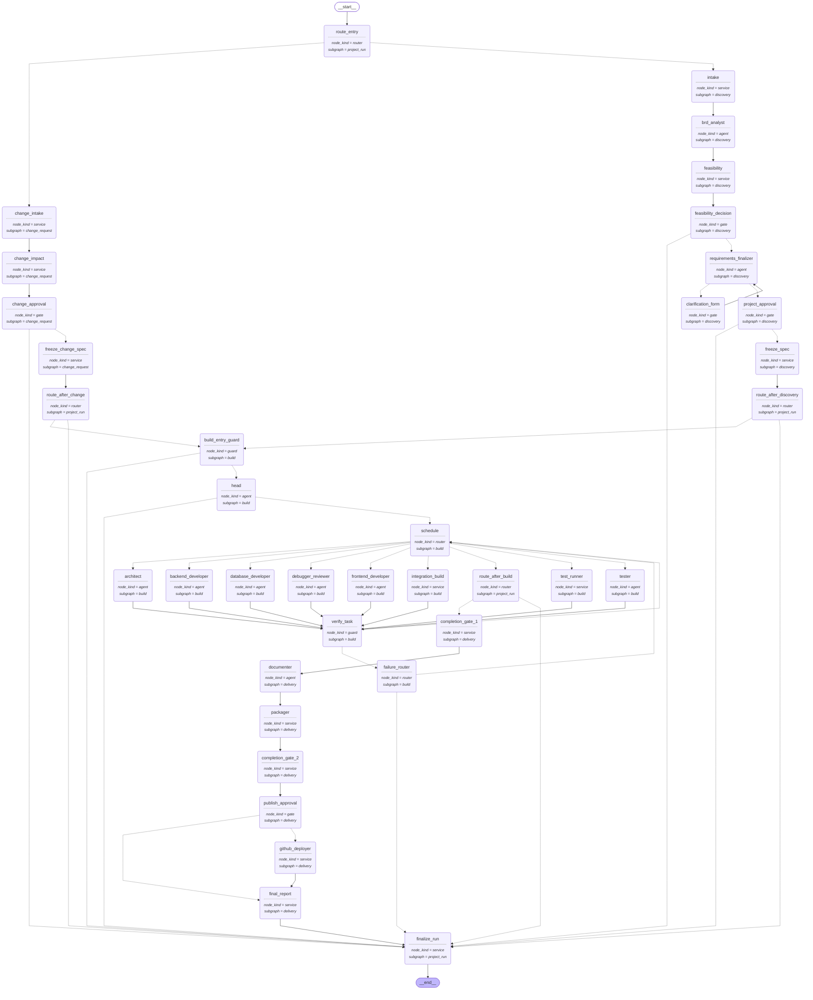

# Orchestration (Part D)

This file is generated by `uv run python -m devteam_orchestration.diagram` from the compiled LangGraph
graph. Do not edit it by hand; `packages/orchestration/tests/test_graph.py` fails when it is out of date.

**How to read it.** One graph, `project_run`. Its edges are exactly the static allowed-transition table
(`devteam_core.contracts.orchestration.ALLOWED_TRANSITIONS`). Dotted edges are choices a node makes; every
choice is checked against the table. Gate nodes stop the run and wait for a human decision. Every path
into Build passes `freeze_spec` (or `freeze_change_spec`) and `build_entry_guard`; every Build and
Delivery node re-checks the frozen, approved specification when it starts.

**Agents.** Exactly ten agent nodes, one per agent (ten-agent layer L4). They run only through the Agent
Executor and the real local Ollama provider (D-44); nothing is simulated. Service steps marked "stand-in"
report only that they did not run, and name the part that delivers them.

## Diagram

## Nodes

| Node | Kind | Subgraph |
|---|---|---|
| `route_entry` | router | project_run |
| `route_after_discovery` | router | project_run |
| `route_after_change` | router | project_run |
| `route_after_build` | router | project_run |
| `finalize_run` | service | project_run |
| `intake` | service | discovery |
| `brd_analyst` | agent | discovery |
| `feasibility` | service | discovery |
| `feasibility_decision` | gate | discovery |
| `requirements_finalizer` | agent | discovery |
| `clarification_form` | gate | discovery |
| `project_approval` | gate | discovery |
| `freeze_spec` | service | discovery |
| `build_entry_guard` | guard | build |
| `head` | agent | build |
| `schedule` | router | build |
| `architect` | agent | build |
| `database_developer` | agent | build |
| `backend_developer` | agent | build |
| `frontend_developer` | agent | build |
| `tester` | agent | build |
| `debugger_reviewer` | agent | build |
| `integration_build` | service | build |
| `test_runner` | service | build |
| `verify_task` | guard | build |
| `failure_router` | router | build |
| `completion_gate_1` | service | delivery |
| `documenter` | agent | delivery |
| `packager` | service | delivery |
| `completion_gate_2` | service | delivery |
| `publish_approval` | gate | delivery |
| `github_deployer` | service | delivery |
| `final_report` | service | delivery |
| `change_intake` | service | change_request |
| `change_impact` | service | change_request |
| `change_approval` | gate | change_request |
| `freeze_change_spec` | service | change_request |
